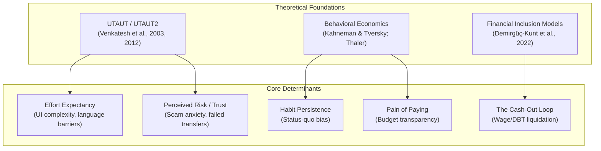

# Systematic Literature Review: The "Capable-but-Cash" Paradox
**Title:** Analyzing India’s Rising Currency in Circulation: An Explainable Machine Learning Approach to the "Capable-but-Cash" Paradox  
**Authors:** Aarush Garg, Arya Wadhwa, Dilraj Singh  
**Affiliation:** RV College of Engineering, Bengaluru, India  

---

## 1. Introduction and Scope of the Review

Over the past decade, India has engineered one of the most comprehensive digital public infrastructure (DPI) ecosystems in the world—colloquially referred to as the "India Stack" (Aadhaar biometrics, Unified Payments Interface [UPI], and Pradhan Mantri Jan Dhan Yojana [PMJDY] financial accounts). Despite the exponential growth of UPI (processing over 14 billion monthly retail transactions valued at over ₹20 lakh crore), physical Currency in Circulation (CiC) continues to rise relentlessly, surpassing ₹42.8 lakh crore ($42.8 \times 10^{12}$ INR) in 2026.

This empirical divergence poses a fundamental macroeconomic and behavioral question: **Why do millions of Indian adults who possess all requisite technological endowments (a formal bank account, a smartphone, and active internet connectivity) continue to rely exclusively on physical cash for in-store purchases?**

This literature review establishes the theoretical, empirical, and methodological foundations needed to investigate this "Capable-but-Cash" paradox.

---

## 2. Macroeconomic Context: The Currency Demand Paradox in India

### 2.1 The Dichotomy of Cash: Medium of Exchange vs. Store of Value
Orthodox monetary theories (e.g., Baumol-Tobin inventory models of money demand) predict that as the transaction costs of accessing non-cash liquidity fall toward zero, transactional cash balances will diminish. 

Recent empirical studies conducted by the Reserve Bank of India (RBI) and independent economists reveal that the persistence of cash is not uniform across use-cases:
* **Transactional Substitution:** UPI has established rapid substitution effects for high-frequency, low-ticket retail transactions (groceries, micro-merchants, local transit) (Mukhopadhyay, 2016; Minj, 2025).
* **Precautionary & Store-of-Value Inelasticity:** As demonstrated by RBI working papers (Awasthy, Misra, & Dhal, 2023) and Kumar & Mishra (2025), aggregate currency demand is overwhelmingly dominated by precautionary savings and store-of-value motives within the informal economy. Unorganized sector households maintain physical liquidity buffers against systemic shocks (health emergencies, agricultural income volatility).
* **Income Elasticity vs. Digital Dampening:** Aggregate econometric models show that India's rising nominal GDP exerts an expansionary income effect on currency demand that exceeds the contractionary substitution effect of digital payment rails (Agarwal, 2023).

### 2.2 Subnational and Structural Asymmetries
Empirical specifications using panel Autoregressive Distributed Lag (ARDL) and quantile regressions indicate that the marginal impact of UPI on reducing cash demand is **non-linear** (RBI Research Bulletins, 2023–2024). In regions where digital infrastructure has reached saturation, the marginal displacement of cash decelerates sharply. This structural floor is maintained by demographics with lower educational attainment, agricultural income structures, and high local ATM density.

---

## 3. Theoretical Frameworks of Digital Payment Adoption

### 3.1 The UTAUT & UTAUT2 Paradigm
The Unified Theory of Acceptance and Use of Technology (UTAUT) (Venkatesh et al., 2003) and its consumer extension UTAUT2 (Venkatesh et al., 2012) represent the predominant conceptual models for technology adoption:
* **Effort Expectancy:** The degree of ease associated with system use. For rural and semi-literate demographics, multi-step smartphone authentication (SMS OTPs, 4-to-6 digit UPI PINs, server latency) introduces cognitive friction compared to cash handover (Slade et al., 2015).
* **Facilitating Conditions & Social Influence:** Oliveira et al. (2016) and Migliore et al. (2022) establish that peer adoption and merchant POS readiness dictate whether an individual feels enabled to transact digitally.
* **Perceived Risk and Initial Trust:** Talwar et al. (2020) and Goyal (2026) investigate post-adoption continuation intention in Indian digital payments, identifying that "fear of transaction failure" (money deducted from bank account without merchant receipt) and scam exposure create asymmetric risk aversion.

### 3.2 Behavioral Economics: Habit, Mental Accounting, and the "Pain of Paying"
Classical adoption models assume rational utility maximization, frequently failing to explain why digitally capable users choose cash when digital payments carry zero merchant fees:
1. **Status-Quo Bias & Habit Persistence:** Samuelson & Zeckhauser (1988) demonstrate that decision-makers disproportionately stick to previous choices even when switching costs are objectively negligible. In payment systems, cash handling represents a deeply ingrained motor and cognitive routine.
2. **Mental Accounting & Budgetary Discipline:** Prelec & Loewenstein (1998) and Soman (2001) formalized the "pain of paying." Physical cash transactions provide immediate tactile and visual cues of balance depletion. For budget-constrained households, paying with cash serves as an automatic self-regulatory spending constraint; digital payments decouple the pain of paying from the consumption experience, causing anxiety over unintended overspending.

### 3.3 The "Cash-Out Loop" Hypothesis
A critical structural friction identified in emerging-market financial inclusion (Demirgüç-Kunt et al., 2022; CGAP, 2021; Sutradhar, 2024) is the **disconnection between account credit and retail spending**. 
When informal sector workers or rural beneficiaries receive wages or Direct Benefit Transfer (DBT) subsidies into their bank accounts, their first action is to withdraw 100% of the funds via an ATM or Bank Mitra (Business Correspondent). Once liquidity is held physically in the wallet, all subsequent merchant transactions inevitably occur in cash, completely bypassing digital point-of-sale rails.

---

## 4. Empirical Literature on Global Findex and Indian Microdata

| Study | Data / Context | Methodology | Core Findings & Relevance |
| :--- | :--- | :--- | :--- |
| **Demirgüç-Kunt et al. (2022)** | Global Findex 2021 (Global & India) | Cross-sectional descriptive & weighted probit | Documents that 78% of Indian adults own accounts, but over 300 million banked individuals make merchant payments solely in cash. Identifies trust, distance, and lack of necessity as primary stated barriers. |
| **Mukhopadhyay (2016)** | Global Findex (2011/2014) & Enterprise Surveys | Theoretical modeling & Logit | Early analysis of India's cashless transition. Showed that consumer adoption is throttled if merchants do not perceive tax incentives to digitize. |
| **Sutradhar (2024)** | Global Findex 2021 (India sample) | Multinomial Logit & descriptive statistics | Evaluates determinants of digital transactions in India. Finds education, formal employment, and income quintile heavily predict digital payment usage, but does not isolate the "capable" cohort. |
| **Maehara et al. (2024)** | National Financial Inclusion Survey (Peru) | Random Forest, XGBoost, Logit | Proves that non-linear ensemble models substantially outperform logistic regression in predicting financial inclusion indicators from survey microdata. |
| **Talwar et al. (2020)** | Indian retail payment survey | Structural Equation Modeling (SEM) | Distinguishes initial trial from continuation intention. Identifies operational friction and perceived security risk as primary causes of reversion to cash. |

---

## 5. Methodological Gap: Why Explainable Machine Learning?

Prior empirical literature examining payment choice relies almost universally on **Binary Logistic Regression** or **Probit Models**. While standard econometric models provide interpretable log-odds coefficients ($\beta$), they suffer from critical analytical drawbacks in complex survey data:
1. **The Linearity Constraint:** Logit assumes a monotonic, linear relationship between continuous predictors (e.g., Age) and log-odds of digital adoption. In reality, adoption often exhibits sharp threshold/tipping effects.
2. **Combinatorial Interaction Failure:** Modeling interactions in regression requires the researcher to manually specify terms (e.g., $\text{Age} \times \text{Income} \times \text{Female}$). In survey datasets with dozens of correlated features, manual specification misses high-order latent interactions.
3. **Multicollinearity:** Socio-demographic indicators (education, income, phone ownership, rurality) exhibit severe collinearity, inflating variance and destabilizing parametric estimates.

### The Machine Learning & TreeSHAP Advantage
Gradient Boosted Decision Trees (XGBoost) naturally capture arbitrary non-linearities and multi-way feature interactions without manual hypothesis specification. By coupling XGBoost with **TreeSHAP (Tree-based SHapley Additive exPlanations)** (Lundberg & Lee, 2017; Lundberg et al., 2020), we retain the predictive superiority of ensemble trees while obtaining mathematically guaranteed, game-theoretically consistent feature attributions.

---

## 6. Hypotheses for the Empirical Investigation

Based on the synthesized literature, we articulate five operational hypotheses to be tested using the Global Findex 2021 India microdata:

* **$H_1$ (The Capability Paradox):** Even when conditioned on universal access (bank account $+$ smartphone $+$ internet), demographic endowments (higher education, upper income quintiles) remain statistically significant positive predictors of digital merchant adoption.
* **$H_2$ (The Cash-Out Loop):** Individuals who receive wages or government transfers in cash, or who frequently withdraw their full balance at ATMs, have significantly higher probability of remaining cash-reliant for merchant purchases.
* **$H_3$ (The Age Non-Linearity):** The effect of age on cash reliance is not linear; rather, a sharp inflection point exists beyond which digital capability fails to overcome ingrained payment habits.
* **$H_4$ (Cognitive vs. Cost Friction):** Usability barriers and trust deficits contribute more strongly to cash reliance in the "capable" cohort than direct transaction fee costs.
* **$H_5$ (Feature Interactions):** The dampening effect of female gender on digital merchant payments is strongly moderated by employment status and independent account access.

---

## 7. Selected Bibliography

1. Agarwal, A. (2023). Less-Cash Societies: A Paradoxical Roadmap Revamped through Unified Payment Systems and Electronic Currencies. *International Journal of Science and Research (IJSR)*, 12(10), 153–158.
2. Awasthy, S., Misra, R., & Dhal, S. (2023). Understanding the Currency Demand Paradox in India. *Reserve Bank of India Working Paper Series*.
3. Chen, T., & Guestrin, C. (2016). XGBoost: A Scalable Tree Boosting System. *ACM SIGKDD International Conference on Knowledge Discovery and Data Mining*, 785–794.
4. Demirgüç-Kunt, A., Klapper, L., Singer, D., & Ansar, S. (2022). *The Global Findex Database 2021: Financial Inclusion, Digital Payments, and Resilience in the Age of COVID-19*. World Bank Publications.
5. Goyal, M. (2026). Determinants of consumer trust and adoption barriers in UPI-based payment applications among adults in India. *International Journal of Research in Finance and Management*, 9(8), 874–881.
6. Kahneman, D., & Tversky, A. (1979). Prospect Theory: An Analysis of Decision under Risk. *Econometrica*, 47(2), 263–291.
7. Kumar, A., & Mishra, A. K. (2025). Understanding India's Currency Demand Absurdity: Cash vs. Digital Payment Methods. *International Journal on Science and Technology*, 16(1), 2919–2928.
8. Lundberg, S. M., & Lee, S.-I. (2017). A Unified Approach to Interpreting Model Predictions. *Advances in Neural Information Processing Systems (NeurIPS)*, 30, 4765–4774.
9. Lundberg, S. M., et al. (2020). From local explanations to global understanding with explainable AI for trees. *Nature Machine Intelligence*, 2(1), 56–67.
10. Maehara, R., Benites, L., & Talavera, A. (2024). Predicting Financial Inclusion in Peru: Application of Machine Learning Algorithms. *Journal of Risk and Financial Management*, 17(1), 34.
11. Mallat, N. (2007). Exploring consumer adoption of mobile payments—A qualitative study. *The Journal of Strategic Information Systems*, 16(4), 413–432.
12. Migliore, G., Wagner, R., & Cechella, F. S. (2022). Antecedents to the Adoption of Mobile Payment: An Integration of UTAUT2 and Innovation Resistance Theory. *Information Systems Frontiers*, 24(6), 2005–2021.
13. Minj, M. (2025). Shift from Cash to Cashless Economy in India: Evidence from RBI & World Bank Data. *Journal of Advances in Developmental Research*, 16(1), 1558–1565.
14. Mukhopadhyay, B. (2016). Understanding cashless payments in India. *Financial Innovation*, 2(1), 27.
15. Oliveira, T., Thomas, M., Baptista, G., & Campos, F. (2016). Mobile payment: Understanding the determinants of customer adoption and intention to recommend the technology. *Computers in Human Behavior*, 61, 404–414.
16. Prelec, D., & Loewenstein, G. (1998). The Red and the Black: Mental Accounting of Savings and Debt. *Marketing Science*, 17(1), 4–28.
17. Samuelson, W., & Zeckhauser, R. (1988). Status quo bias in decision making. *Journal of Risk and Uncertainty*, 1(1), 7–59.
18. Slade, E. L., Dwivedi, Y. K., Piercy, N. C., & Williams, M. D. (2015). Modeling consumers’ adoption intentions of remote mobile payments in the United Kingdom: Extending UTAUT with innovativeness, risk, and trust. *Psychology & Marketing*, 32(8), 860–873.
19. Soman, D. (2001). Effects of payment mechanism on spending behavior: The role of rehearsal and immediacy of payments. *Journal of Consumer Research*, 27(4), 460–474.
20. Sutradhar, T. K. (2024). Status and Determinants of Digital Transactions in India: Findings from the New Global Findex Database. *Vidyasagar University Journal of Economics*, 28, 21–38.
21. Talwar, S., Dhir, A., & Khalil, A. (2020). Point of adoption and beyond: Initial trust and mobile-payment continuation intention. *Journal of Retailing and Consumer Services*, 55, 102086.
22. Thaler, R. H. (1999). Mental accounting matters. *Journal of Behavioral Decision Making*, 12(3), 183–206.
23. Venkatesh, V., Morris, M. G., Davis, G. B., & Davis, F. D. (2003). User acceptance of information technology: Toward a unified view. *MIS Quarterly*, 27(3), 425–478.
24. Venkatesh, V., Thong, J. Y., & Xu, X. (2012). Consumer acceptance and use of information technology: Extending the unified theory of acceptance and use of technology. *MIS Quarterly*, 36(1), 157–178.
