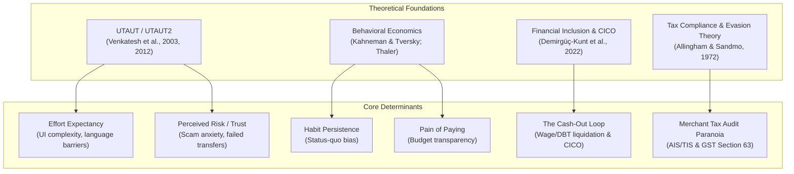

# Systematic Literature Review: The "Capable-but-Cash" Paradox
**Title:** Analyzing India’s Rising Currency in Circulation: An Explainable Machine Learning Approach to the "Capable-but-Cash" Paradox  
**Authors:** Aarush Garg, Arya Wadhwa, Dilraj Singh, Dr. Vivekanand S Gogi  
**Affiliation:** RV College of Engineering, Bengaluru, India (Dept. of Computer Science & Engineering [AI & ML]; Dept. of Industrial Engineering & Management)  

---

## 1. Introduction and Scope of the Review

Over the past decade, India has engineered one of the most comprehensive digital public infrastructure (DPI) ecosystems in the world—colloquially referred to as the "India Stack" (Aadhaar biometrics, Unified Payments Interface [UPI], and Pradhan Mantri Jan Dhan Yojana [PMJDY] financial accounts). Despite the exponential growth of UPI (scaling from 16.58 billion monthly transactions worth ₹23.49 lakh crore in October 2024 to 25.47 billion monthly transactions worth ₹31.53 lakh crore in October 2026), physical banknotes in circulation rose 11.9% YoY to ₹41.24 lakh crore in March 2026, with total Currency in Circulation (CiC) exceeding ₹43 lakh crore later in 2026.

This empirical divergence poses a fundamental macroeconomic, behavioral, and regulatory question: **Why do millions of Indian adults who possess all requisite technological endowments (a formal bank account, a smartphone, and active internet connectivity) continue to rely exclusively on physical cash for in-store purchases?**

This literature review establishes the theoretical, empirical, tax-compliance, and methodological foundations needed to investigate this "Capable-but-Cash" paradox.

---

## 2. Macroeconomic Context: The Currency Demand Paradox in India

### 2.1 The Dichotomy of Cash: Medium of Exchange vs. Store of Value
Orthodox monetary theories (e.g., Baumol-Tobin inventory models of money demand) predict that as the transaction costs of accessing non-cash liquidity fall toward zero, transactional cash balances will diminish. 

Recent empirical studies conducted by the Reserve Bank of India (RBI) and independent economists reveal that the persistence of cash is not uniform across use-cases:
* **Transactional Substitution:** UPI has established rapid substitution effects for high-frequency, low-ticket retail transactions (groceries, micro-merchants, local transit) (Mukhopadhyay, 2016; Awasthy & Seet, 2025).
* **Precautionary & Store-of-Value Inelasticity:** As demonstrated by RBI occasional papers (Awasthy, Misra, & Dhal, 2022) and subnational UPI studies (Awasthy & Seet, 2025), aggregate currency demand is heavily sustained by precautionary savings and store-of-value motives within the informal economy. Unorganized sector households maintain physical liquidity buffers against systemic shocks (health emergencies, agricultural income volatility).
* **Income Elasticity vs. Digital Dampening:** Subnational econometric evaluations show that while UPI dampens transactional cash demand, rising income, ATM density, and informal workforce concentration sustain physical currency holdings (Awasthy & Seet, 2025; Ashworth & Goodhart, 2020).

---

## 3. Theoretical Frameworks of Digital Payment Adoption

### 3.1 The UTAUT & UTAUT2 Paradigm
The Unified Theory of Acceptance and Use of Technology (UTAUT) (Venkatesh et al., 2003) and its consumer extension UTAUT2 (Venkatesh et al., 2012) represent the predominant conceptual models for technology adoption:
* **Effort Expectancy:** The degree of ease associated with system use. For rural and semi-literate demographics, multi-step smartphone authentication (SMS OTPs, 4-to-6 digit UPI PINs, server latency) introduces cognitive friction compared to cash handover (Slade et al., 2015).
* **Facilitating Conditions & Social Influence:** Oliveira et al. (2016) and Migliore et al. (2022) establish that peer adoption and merchant POS readiness dictate whether an individual feels enabled to transact digitally.
* **Perceived Risk and Initial Trust:** Talwar et al. (2020) investigate post-adoption continuation intention in Indian digital payments, identifying that "fear of transaction failure" (money deducted from bank account without merchant receipt) and security risk create asymmetric risk aversion.

### 3.2 Behavioral Economics: Habit, Mental Accounting, and the "Pain of Paying"
Classical adoption models assume rational utility maximization, frequently failing to explain why digitally capable users choose cash when digital payments carry zero merchant fees:
1. **Status-Quo Bias & Habit Persistence:** Samuelson & Zeckhauser (1988) demonstrate that decision-makers disproportionately stick to previous choices even when switching costs are objectively negligible. In payment systems, cash handling represents a deeply ingrained motor and cognitive routine.
2. **Mental Accounting & Budgetary Discipline:** Prelec & Loewenstein (1998) and Soman (2001) formalized the "pain of paying." Physical cash transactions provide immediate tactile and visual cues of balance depletion. For budget-constrained households, paying with cash serves as an automatic self-regulatory spending constraint; digital payments decouple the pain of paying from the consumption experience, causing anxiety over unintended overspending.

### 3.3 The "Cash-Out Loop" Hypothesis
A critical structural friction identified in emerging-market financial inclusion (Demirgüç-Kunt et al., 2022; Hernandez et al., 2020; Sutradhar, 2024) is the **disconnection between account credit and retail spending**.
When informal sector workers or rural beneficiaries receive wages or Direct Benefit Transfer (DBT) subsidies into their bank accounts, their first action is often to withdraw 100% of the funds via an ATM or CICO agent. Once liquidity is held physically in the wallet, all subsequent merchant transactions inevitably occur in cash, completely bypassing digital point-of-sale rails.

### 3.4 Merchant-Side Tax Scrutiny & The "Flight Back to Cash"
A crucial institutional force that reinforces consumer cash reliance is **merchant refusal driven by tax-compliance anxiety**:
1. **The Myth of the "UPI Tax":** Consumer bank-to-bank UPI transfers (P2P and P2M) are free under zero-MDR regulations. While NPCI introduced an interchange fee of up to 1.1% on merchant Prepaid Payment Instrument (PPI) wallet transactions over ₹2,000 in 2023, public misunderstanding fostered rumors that all digital receipts attract direct taxes.
2. **Automated Tax Auditing via AIS / TIS:** Under Section 285BA of the Income Tax Act (Statement of Financial Transactions), reporting financial institutions transmit prescribed transaction records to tax authorities, populating taxpayers' **Annual Information Statement (AIS)** and **Taxpayer Information Summary (TIS)**.
3. **GST Section 63 Enforcement:** Small suppliers whose aggregate annual turnover crosses statutory GST registration thresholds (₹20 lakh for services, ₹40 lakh for goods in most states) face Best Judgment Assessment under **Section 63 of the CGST Act** for operating without registration.
4. **Behavioral Outcome:** Informal retailers actively suppress digital QR transactions and mandate physical cash (*"server down / cash preferred"*), directly locking digitally equipped buyers into cash payments.

---

## 4. Empirical Literature on Global Findex and Indian Microdata

| Study | Data / Context | Methodology | Core Findings & Relevance |
| :--- | :--- | :--- | :--- |
| **Demirgüç-Kunt et al. (2022)** | Global Findex 2021 (Global & India) | Cross-sectional descriptive & survey-weighted indicators | Documents that 77.5% of Indian adults own accounts, while 670 million banked individuals make merchant payments solely in cash. Identifies trust, distance, and lack of necessity as primary stated barriers. |
| **Klapper et al. (2025)** | Global Findex 2025 Database (`IND_2024_FINDEX`) | Digital Connectivity Tracker & financial inclusion indicators | Establishes the post-pandemic digital infrastructure baseline, tracking smartphone ownership, regular internet usage, and safety concerns. |
| **Mukhopadhyay (2016)** | Global Findex (2011/2014) & Enterprise Surveys | Theoretical modeling & econometric evaluation | Early analysis of India's cashless transition. Showed that consumer adoption is throttled if merchants do not perceive net incentives to digitize. |
| **Sutradhar (2024)** | Global Findex (India sample) | Binary Logit / Probit & descriptive statistics | Evaluates determinants of digital transactions in India. Finds education, formal employment, and income quintile strongly predict digital payment usage, but does not isolate the "capable" cohort. |
| **Maehara et al. (2024)** | National Financial Inclusion Survey (Peru) | Random Forest, XGBoost, Logit | Demonstrates that non-linear ensemble models outperform standard logistic regression in predicting financial inclusion indicators from survey microdata. |
| **Talwar et al. (2020)** | Indian mobile-payment user survey | Structural Equation Modeling (SEM) & complexity theory | Distinguishes point-of-adoption from continuation intention. Identifies initial trust and usage barriers as central determinants of mobile-payment continuation. |

---

## 5. Methodological Gap: Why Explainable Machine Learning?

Prior empirical literature examining payment choice relies almost universally on **Binary Logistic Regression** or **Probit Models**. While standard econometric models provide interpretable log-odds coefficients ($\beta$), they suffer from critical analytical drawbacks in complex survey data:
1. **The Linearity Constraint:** Logit assumes a monotonic, linear relationship between continuous predictors (e.g., Age) and log-odds of digital adoption. In reality, adoption often exhibits sharp threshold/tipping effects.
2. **Combinatorial Interaction Failure:** Modeling interactions in regression requires the researcher to manually specify terms (e.g., $\text{Age} \times \text{Income} \times \text{Female}$). In survey datasets with dozens of correlated features, manual specification misses high-order latent interactions.
3. **Multicollinearity:** Socio-demographic indicators (education, income, phone ownership, rurality) exhibit severe collinearity, inflating variance and destabilizing parametric estimates.

### The Machine Learning & TreeSHAP Advantage
Gradient Boosted Decision Trees (XGBoost) naturally capture arbitrary non-linearities and multi-way feature interactions without manual hypothesis specification. By coupling XGBoost with **TreeSHAP (Tree-based SHapley Additive exPlanations)** (Lundberg & Lee, 2017; Lundberg et al., 2020), we retain the predictive superiority of ensemble trees while obtaining mathematically guaranteed, game-theoretically consistent feature attributions.

---

### 6. Selected Bibliography

1. Allingham, M. G., & Sandmo, A. (1972). Income tax evasion: A theoretical analysis. *Journal of Public Economics*, 1(3–4), 323–338.
2. Arango, C., Huynh, K. P., & Sabetti, L. (2015). Consumer payment choice: Merchant card acceptance versus pricing incentives. *Journal of Banking & Finance*, 55, 130–141.
3. Ashworth, J., & Goodhart, C. A. E. (2020). Coronavirus panic fuels a surge in cash demand. *CEPR Discussion Paper*, DP14910.
4. Awasthy, S., Misra, R., & Dhal, S. (2022). Cash versus Digital Payment Transactions in India: Decoding the Currency Demand Paradox. *Reserve Bank of India Occasional Papers*, 43(2), 1–45.
5. Awasthy, S., & Seet, S. K. (2025). Impact of UPI on Cash Demand – Evidence from National and Subnational Levels. *Reserve Bank of India (RBI) Bulletin*, Sep. 2025, 79 ff.
6. Baumol, W. J. (1952). The Transactions Demand for Cash: An Inventory Theoretic Approach. *The Quarterly Journal of Economics*, 66(4), 545–556.
7. Chen, T., & Guestrin, C. (2016). XGBoost: A Scalable Tree Boosting System. *Proceedings of ACM SIGKDD*, 785–794.
8. DeLong, E. R., DeLong, D. M., & Clarke-Pearson, D. L. (1988). Comparing the areas under two or more correlated receiver operating characteristic curves: a nonparametric approach. *Biometrics*, 44(3), 837–845.
9. Demirgüç-Kunt, A., Klapper, L., Singer, D., & Ansar, S. (2022). *The Global Findex Database 2021: Financial Inclusion, Digital Payments, and Resilience in the Age of COVID-19*. World Bank Publications.
10. D'Silva, D., Filková, Z., Packer, F., & Tiwari, S. (2019). The design of digital financial infrastructure: lessons from India. *BIS Papers*, No. 106.
11. Duarte, A., Frost, J., Gambacorta, L., Koo Wilkens, P., & Shin, H. S. (2022). Central banks, the monetary system and public payment infrastructures: lessons from Brazil's instant payment system. *BIS Bulletin*, No. 52.
12. Fairlie, R. W. (2005). An extension of the Blinder-Oaxaca decomposition technique to logit and probit models. *Journal of Economic and Social Measurement*, 30(4), 305–316.
13. GSMA / Jeffrie, N. (2023). *The Mobile Gender Gap Report 2023*. GSM Association.
14. Hernandez, E., Blackburn, C., Raman, A., & Reynolds, P. (2020). *Agent Network Journeys Toward the Last Mile: A Cross-Country Perspective*. CGAP / World Bank Group.
15. Kahneman, D., & Tversky, A. (1979). Prospect Theory: An Analysis of Decision under Risk. *Econometrica*, 47(2), 263–291.
16. Klapper, L., Singer, D., Starita, L., & Norris, A. (2025). *The Global Findex Database 2025: Connectivity and Financial Inclusion in the Digital Economy*. World Bank Publications.
17. Lundberg, S. M., & Lee, S.-I. (2017). A Unified Approach to Interpreting Model Predictions. *Advances in Neural Information Processing Systems (NeurIPS)*, 30, 4765–4774.
18. Lundberg, S. M., Erion, G., Chen, H., DeGrave, A., Prutkin, J. M., Nair, B., Katz, R., Himmelfarb, J., Bansal, N., & Lee, S.-I. (2020). From local explanations to global understanding with explainable AI for trees. *Nature Machine Intelligence*, 2(1), 56–67.
19. Maehara, R., Benites, L., Talavera, A., Aybar-Flores, A., & Muñoz, M. (2024). Predicting Financial Inclusion in Peru: Application of Machine Learning Algorithms. *Journal of Risk and Financial Management*, 17(1), 34.
20. Mallat, N. (2007). Exploring consumer adoption of mobile payments—A qualitative study. *The Journal of Strategic Information Systems*, 16(4), 413–432.
21. Migliore, G., Wagner, R., Cechella, F. S., & Liébana-Cabanillas, F. (2022). Antecedents to the Adoption of Mobile Payment in China and Italy: an Integration of UTAUT2 and Innovation Resistance Theory. *Information Systems Frontiers*, 24(6), 2099–2122.
22. Mukhopadhyay, B. (2016). Understanding cashless payments in India. *Financial Innovation*, 2(1), 27.
23. NPCI. (2026). *UPI Product Statistics*. National Payments Corporation of India.
24. Oliveira, T., Thomas, M., Baptista, G., & Campos, F. (2016). Mobile payment: Understanding the determinants of customer adoption and intention to recommend the technology. *Computers in Human Behavior*, 61, 404–414.
25. Prelec, D., & Loewenstein, G. (1998). The Red and the Black: Mental Accounting of Savings and Debt. *Marketing Science*, 17(1), 4–28.
26. Reserve Bank of India. (2026). *Annual Report 2025–26*. Reserve Bank of India Publications.
27. Samuelson, W., & Zeckhauser, R. (1988). Status quo bias in decision making. *Journal of Risk and Uncertainty*, 1(1), 7–59.
28. Slade, E. L., Dwivedi, Y. K., Piercy, N. C., & Williams, M. D. (2015). Modeling Consumers' Adoption Intentions of Remote Mobile Payments in the United Kingdom: Extending UTAUT with Innovativeness, Risk, and Trust. *Psychology & Marketing*, 32(8), 860–873.
29. Soman, D. (2001). Effects of Payment Mechanism on Spending Behavior: The Role of Rehearsal and Immediacy of Payments. *Journal of Consumer Research*, 27(4), 460–474.
30. Sutradhar, T. K. (2024). Status and Determinants of Digital Transactions in India: Findings from the New Global Findex Database. *Vidyasagar University Journal of Economics*.
31. Talwar, S., Dhir, A., Khalil, A., Mohan, G., & Najmul Islam, A. K. M. (2020). Point of adoption and beyond. Initial trust and mobile-payment continuation intention. *Journal of Retailing and Consumer Services*, 55, 102086.
32. Thaler, R. H. (1999). Mental accounting matters. *Journal of Behavioral Decision Making*, 12(3), 183–206.
33. Tobin, J. (1956). The Interest-Elasticity of Transactions Demand For Cash. *The Review of Economics and Statistics*, 38(3), 241–247.
34. Venkatesh, V., Morris, M. G., Davis, G. B., & Davis, F. D. (2003). User acceptance of information technology: Toward a unified view. *MIS Quarterly*, 27(3), 425–478.
35. Venkatesh, V., Thong, J. Y. L., & Xu, X. (2012). Consumer acceptance and use of information technology: Extending the unified theory of acceptance and use of technology. *MIS Quarterly*, 36(1), 157–178.
36. World Bank. (2023). *G20 Policy Recommendations for Advancing Financial Inclusion and Productivity Gains through Digital Public Infrastructure*. World Bank Group.
37. Yun, M.-S. (2004). Decomposing differences in the first moment. *Economics Letters*, 82(2), 275–280.
