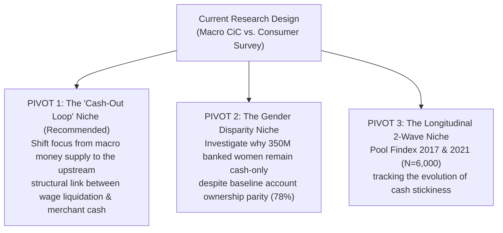

# Critical Review & Niche Pivot Strategy
**Project:** *Analyzing India’s Rising Currency in Circulation: An Explainable Machine Learning Approach to the "Capable-but-Cash" Paradox*  
**Authors:** Aarush Garg, Arya Wadhwa, Dilraj Singh, Dr. Vivekanand S Gogi  
**Institution:** RV College of Engineering, Bengaluru, India (Dept. of Computer Science & Engineering; Dept. of Industrial Engineering & Management)  

> **Archival Note (Phase I Planning Memo):** This document records the early Phase I peer-review scoping critique (against earlier 2024 snapshot figures of 14.9B monthly UPI transactions and ₹42.8 lakh crore CiC) that motivated the final two-wave econometrics, TreeSHAP interaction, and 2024 Connectivity Tracker pipeline documented in `paper/paper.tex` and `paper/RESEARCH_PAPER.md`.

---

## 1. Executive Summary & Critical Review

While India’s digital retail payments ecosystem has scaled past 14.9 billion monthly transactions via UPI, physical Currency in Circulation (CiC) continues to rise, surpassing ₹42.8 lakh crore. 

This document captures an adversarial, rigorous peer-review assessment of our current research design, identifies methodological vulnerabilities that academic reviewers will target, and establishes three concrete, publishable niche pivots.

---

## 2. The Four Core Methodological Vulnerabilities

### Vulnerability 1: The Macro-Micro Scale Mismatch
* **The Claim:** Using individual retail merchant payment survey data (Global Findex) to explain a macroeconomic central-bank currency stock (₹42.8 lakh crore).
* **The Reality:** The vast majority of physical cash stock in India is not held for everyday retail purchases (groceries/milk). As Reserve Bank of India (RBI) research confirms, CiC is primarily driven by:
  1. Precautionary savings in the unorganized economy.
  2. Working capital for informal MSMEs and agricultural traders.
  3. Store-of-value holdings in real estate and unrecorded transactions.
* **Reviewer Pushback:** *Ecological fallacy*—attributing aggregate macroeconomic money supply trends entirely to individual consumer point-of-sale choices.

### Vulnerability 2: Temporal Lag (2021 Survey Wave vs. 2026 Payment Realities)
* **The Reality:** Global Findex 2021 data was collected during late 2021 (mid-pandemic recovery).
  * In 2021, monthly UPI volume was 3.5–4.5 billion (vs. 15+ billion in 2024–2026).
  * Audio QR Soundboxes (Paytm/PhonePe instant voice payment confirmations) had barely penetrated Tier-2 to rural merchants in 2021. Today, they are ubiquitous.
  * UPI Lite (zero-PIN on-device wallets) was not yet operational.
* **Reviewer Pushback:** *Obsolescence*—drawing conclusions about modern UPI-era cash persistence using data collected prior to soundbox and offline-rail diffusion.

### Vulnerability 3: The Filtered Sample Size Bottleneck
* **The Reality:** While the full India Findex dataset has $N = 3,000$ respondents:
  * Applying the "Capable" filter ($\text{Account} = 1 \land \text{Mobile} = 1 \land \text{Internet} = 1$) isolates approximately $N \approx 350\text{--}450$ respondents.
  * In an 80/20 train/test split, the test set is only $n \approx 70\text{--}80$ observations.
* **Reviewer Pushback:** Small positive class evaluation makes performance metrics (ROC-AUC, F1) sensitive to small perturbations.

### Vulnerability 4: Survey Proxies vs. Deep Psychological Constructs
* **The Reality:** Findex is an economic access survey, not a psychometric battery. It contains discrete binary indicators, not continuous Likert scales measuring PIN anxiety or mental accounting salience.

---

## 3. The Three Publishable Niche Pivots

### Pivot Option 1: The "Cash-Out Loop" Niche (Strongest Recommendation)
* **Refined Title:** *Breaking the Cash-Out Loop: An Explainable Machine Learning Analysis of Wage Liquidation and Retail Payment Friction in India.*
* **Strategic Shift:** 
  * Relegate the ₹42.8 lakh crore macro number strictly to an introductory backdrop.
  * Center the research question on **liquidity entry**: In Findex 2021, over 62% of workers receive wages in cash, and DBT transfers are immediately liquidated via ATMs.
  * Demonstrate that consumer retail cash preference is an inevitable downstream consequence of physical wage disbursement.
* **Target Publication:** *Financial Innovation* (Springer, Q1), IEEE TEMSCON, or IEEE CONECCT.

### Pivot Option 2: The Gender Usage Gap Niche
* **Refined Title:** *The Illusion of Parity: An Explainable AI Audit of the Gender Usage Gap in India's Digital Payment Ecosystem.*
* **Strategic Shift:** 
  * Exploit the striking empirical anomaly: Indian men and women have identical account ownership rates (77.5%), yet **350 million of the 670 million cash-only banked adults are women**.
  * Use XGBoost + TreeSHAP to uncover intra-household barriers, shared device friction, and cash envelope budgeting.
* **Target Publication:** *World Development*, *Electronic Commerce Research and Applications* (Elsevier, Q1).

### Pivot Option 3: Two-Wave Pooled Dynamics (2017 vs. 2021)
* **Refined Title:** *From Demonetization to the UPI Era: A Longitudinal Machine Learning Audit of Persistent Cash Reliance in India (2017–2021).*
* **Strategic Shift:** 
  * Pool the Global Findex 2017 ($N = 3,000$) and 2021 ($N = 3,000$) datasets into a single $N = 6,000$ sample.
  * Solves the sample size limitation, doubling the "capable" cohort to $>1,000$ observations.
  * Evaluates how the drivers of cash reliance evolved across the two survey waves.
* **Target Publication:** *Journal of Risk and Financial Management*, IEEE BigData.

---

## 4. Evaluation Strategy for Phase II Review

When presenting to faculty evaluators:
1. **Acknowledge the Macro-Micro Distinction:** Explicitly state that our model evaluates **micro-level behavioral choices at retail points of sale**, not central-bank macro money demand.
2. **Highlight the "Cash-Out Loop":** Emphasize that retail payment digitisation fails when liquidity enters households as physical notes.
3. **Defend Methodological Rigor:** Point out that we benchmark against survey-weighted Logistic Regression, preserve sampling weights, and use TreeSHAP for exact game-theoretic attributions.
