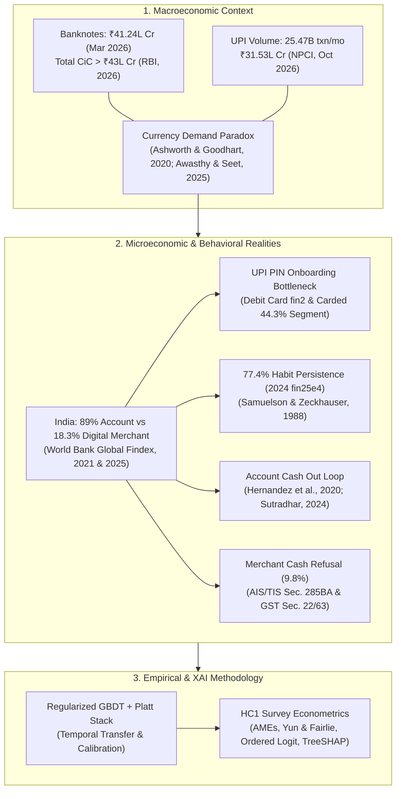
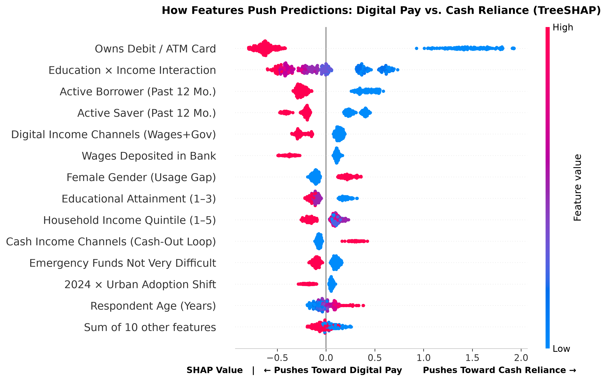
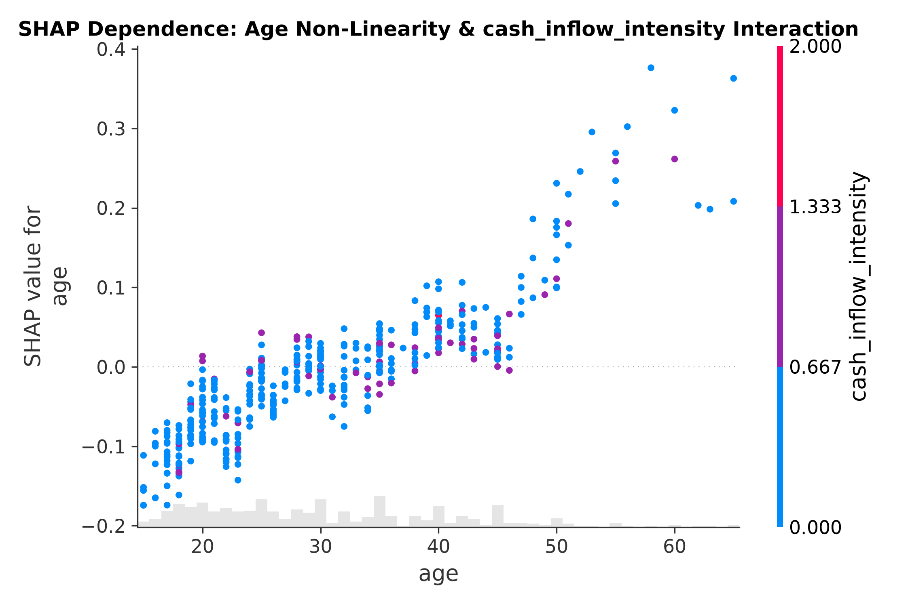
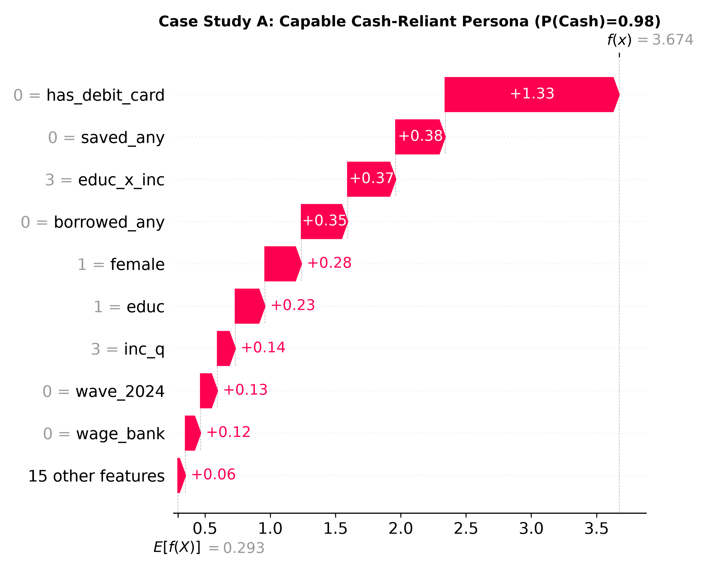
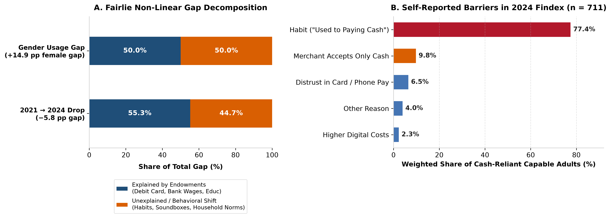

# Analyzing India's Rising Currency in Circulation: An Explainable Machine Learning and Econometric Study of the "Capable but Cash" Paradox

**Aarush Garg**¹, **Arya Wadhwa**¹, **Dilraj Singh**¹, and **Dr. Vivekanand S Gogi**²  
¹*Department of Computer Science and Engineering, RV College of Engineering, Bengaluru, India*  
²*Department of Industrial Engineering and Management, RV College of Engineering, Bengaluru, India*  
*Emails: `aarushgarg.ai24@rvce.edu.in`, `aryawadhwa.ai24@rvce.edu.in`, `dilrajsingh.ai24@rvce.edu.in`, `vivekanands@rvce.edu.in`*

---

## Abstract

Although monthly retail transactions on India's Unified Payments Interface (UPI) grew from 16.58 billion (₹23.49 lakh crore) in October 2024 to 25.47 billion (₹31.53 lakh crore) in October 2026 (NPCI, 2026), banknotes in circulation still expanded by 11.9% in FY 2025 to 2026 to ₹41.24 lakh crore in March 2026, with total currency in circulation exceeding ₹43 lakh crore later that year (Reserve Bank of India, 2026). Adult bank account ownership reached 89.0% in 2024, yet weighted digital merchant payment adoption in India stood at only 18.3%, less than half the 42% developing economy average (Klapper et al., 2025). Pooling official World Bank Global Findex India microdata across the 2021 and 2025 (2024 wave) surveys ($N = 6,000$), we isolate the **"Capable but Cash"** cohort ($N_{\text{cap}} = 2,172$) comprising adults who hold a bank account, own a mobile phone, and access the internet. Within this group, 55.7% unweighted (60.57% in 2021, 54.80% weighted in 2024, and 53.16% among smartphone owners) continue to pay merchants exclusively in cash. In the 2024 Findex wave (`fin25e4`), **77.4%** cite ingrained cash habit (*"used to paying cash"*), **9.8%** cite merchant refusal, **6.5%** cite distrust, and **2.3%** cite higher fees. Combining weighted Huber and White (HC1) Spline Logit regressions, regularized XGBoost and LightGBM, a Platt calibrated four model stacking ensemble (5×3 CV ROC AUC = $0.8483 \pm 0.025$; holdout test AUC = $0.8426$), temporal transfer validation, order invariant Yun and Fairlie bootstrap decompositions, ordered logit frequency models, and TreeSHAP attributions, we show that tree ensembles generalize better under temporal shift (2024 to 2021 AUC $0.8622$ versus $0.8291$). Debit card absence acts as the primary onboarding bottleneck alongside a 44.3% carded behavioral segment, and counterfactual parity in cardless onboarding and bank payroll associates with cash reliance declines of $-8.83$ to $-14.48$ percentage points.

**Keywords:** Financial Inclusion, Digital Payments, Unified Payments Interface (UPI), Currency Demand Paradox, Tax Compliance Friction, AIS/TIS Tracking, Explainable AI, TreeSHAP, XGBoost, Econometric Decomposition, Global Findex.

---

## I. Introduction

India's digital public infrastructure combines Aadhaar biometric identification, universal bank accounts under Pradhan Mantri Jan Dhan Yojana (PMJDY), and the Unified Payments Interface (UPI) developed by the National Payments Corporation of India (NPCI), reducing the marginal cost of retail electronic transfers close to zero (World Bank, 2023; D'Silva et al., 2019; NPCI, 2026). Classical inventory models of money demand predict that falling transaction costs steadily compress physical currency holdings (Baumol, 1952; Tobin, 1956).

Reserve Bank of India (RBI) and World Bank data reveal two distinct gaps:
1. **Macro Digital versus Cash Trends:** Monthly UPI transactions scaled from **16.58 billion** (₹23.49 lakh crore) in October 2024 to **25.47 billion** transactions worth **₹31.53 lakh crore** in October 2026, reaching ₹314.23 lakh crore across FY 2025 to 2026 (NPCI, 2026). Over the same span, India's banknotes in circulation grew **11.9%** annually from ₹36.87 lakh crore (March 2025) to **₹41.24 lakh crore** (March 2026), with total currency in circulation exceeding ₹43 lakh crore later in 2026 and concentrating heavily in ₹500 notes (RBI, 2026; Awasthy, Misra, & Dhal, 2022).
2. **Account Ownership versus Merchant Usage:** India expanded adult account ownership from **77.5%** in 2021 to **89.0%** in 2024 (Demirgüç-Kunt et al., 2022; Klapper et al., 2025), matching peers such as Kenya (above 89%) and Brazil (around 90%). Yet India's weighted digital merchant payment rate (`merchantpay_dig`) in 2024 is only **18.3%** (up from **11.9%** in 2021), compared with **42%** across developing economies (up from 35% in 2021) and **56%** in Kenya (Klapper et al., 2025), while Brazil's Pix accelerated formal merchant cash displacement (Duarte et al., 2022).

Aggregate currency holdings reflect precautionary hoarding and informal enterprise working capital alongside retail checkout behavior (Ashworth & Goodhart, 2020; Awasthy et al., 2022; Awasthy & Seet, 2025). To avoid ecological fallacy, this paper focuses directly on individual point of sale payment choice through the **"Capable but Cash" Paradox**:
> *Among Indian adults who already possess a formal bank account, personal mobile phone, and active internet access, which structural, behavioral, and digital literacy barriers sustain exclusive cash usage at checkout, and how did these drivers evolve between 2021 and 2024?*

---

## II. Literature Review & Theoretical Grounding

### A. Currency Demand Paradox and Peer Benchmarks
Monetary research across advanced and emerging economies documents the coexistence of electronic payment expansion and rising banknote demand (Ashworth & Goodhart, 2020; Arango, Huynh, & Sabetti, 2015). In India, Awasthy, Misra, & Dhal (2022) and Awasthy & Seet (2025) find through national and subnational RBI studies that while UPI displaces transactional cash in small retail payments, precautionary liquidity, informal sector cash preference, rising incomes, and literacy gaps sustain currency stocks. Globally, Duarte et al. (2022) attribute Brazil's rapid cash displacement under Pix to mandatory participation of major institutions and open merchant interoperability.

### B. UTAUT2, Effort Expectancy, and PIN Onboarding Friction
UTAUT and UTAUT2 (Venkatesh, Morris, Davis, & Davis, 2003; Venkatesh, Thong, & Xu, 2012) identify effort expectancy, facilitating conditions, and perceived risk as core adoption determinants (Slade et al., 2015; Oliveira et al., 2016; Migliore et al., 2022). In India, multistep authentication (SMS OTPs, four to six digit UPI PINs, and English script interfaces) adds cognitive friction, while fear of failed settlement and phishing erodes continued usage (Talwar et al., 2020). Historically, UPI PIN creation required entering active debit card digits and expiry dates before broader Aadhaar OTP rollout, making cardlessness a major blocker for banked smartphone users.

### C. Behavioral Inertia and the Account Cash Out Loop
Behavioral economics explains why zero transaction fees rarely overturn cash habits immediately:
1. **Status Quo Bias and Habit:** Individuals stick to familiar payment routines even when switching costs are low (Samuelson & Zeckhauser, 1988).
2. **Mental Accounting and Pain of Paying:** Physical cash creates immediate visual and tactile awareness of spending limits (Prelec & Loewenstein, 1998; Thaler, 1999; Soman, 2001).
3. **Account Cash Out Loop:** When informal workers or welfare recipients receive wages in cash, or withdraw bank deposits immediately at ATMs or banking agents, subsequent retail purchases stay anchored in cash (Demirgüç-Kunt et al., 2022; Hernandez et al., 2020; Sutradhar, 2024).

### D. Merchant Tax Compliance Friction
Consumer payment choice is bounded by vendor acceptance (Arango et al., 2015). Under Section 285BA of India's Income Tax Act, reporting institutions transmit digital settlement totals to CBDT's **Annual Information Statement (AIS)** and **Taxpayer Information Summary (TIS)**. Although Section 44AD raises presumptive taxation limits to ₹3 crore (6% versus 8% tax rate) when at least 95% of receipts are digital, small vendors face lower **GST registration thresholds** (₹20 lakh services, ₹40 lakh goods under Sections 22 and 63 of the CGST Act), motivating informal stores to hide QR codes and insist on cash.

### E. Combining Explainable ML and HC1 Econometrics
Empirical payment studies commonly rely on binary logit or probit models (Mukhopadhyay, 2016; Sutradhar, 2024), which miss threshold patterns unless interactions are manually encoded. Regularized gradient boosted trees (Chen & Guestrin, 2016; Maehara et al., 2024) paired with TreeSHAP (Lundberg et al., 2020) detect multiway interactions directly, while weighted HC1 econometrics, Yun and Fairlie decompositions (Yun, 2004; Fairlie, 2005), and ordered logit models provide formal standard errors and confidence intervals.

---

## III. Data Operationalization: World Bank Global Findex (India)

### A. Pooled Two Wave Survey Design
We pool nationally representative India microdata from **Global Findex 2021** (`IND_2021_FINDEX_v02_M`, $N = 3,000$, 119 indicators) (Demirgüç-Kunt et al., 2022) and **Global Findex 2025 / 2024 Wave** (`IND_2024_FINDEX_v02_M`, $N = 3,000$, 199 indicators including the Digital Connectivity Tracker) (Klapper et al., 2025), totaling $N = 6,000$ adults aged 15 and older. Survey weights (`wgt`) sum to 3,000 per wave. Table I compiles external institutional figures alongside weighted Findex baselines.

**Table I: Institutional Macro Context and Global Findex India Baselines**
| Empirical Metric | Value | Primary Official Source |
| :--- | :---: | :--- |
| **India Banknotes in Circulation (Mar 2026)** | **₹41.24 Lakh Crore** | Reserve Bank of India (RBI, 2026) *Annual Report 2025 to 2026* |
| **Banknote Value Growth (FY 2025 to 2026)** | **11.9%** | Reserve Bank of India (RBI, 2026) *Annual Report 2025 to 2026* |
| **Monthly UPI Volume / Value (Oct 2026)** | **25.47B / ₹31.53L Cr** | NPCI (2026) *UPI Product Statistics* (Oct 2024: 16.58B / ₹23.49L Cr) |
| **Adult Account Ownership (2021 to 2024)** | **77.5% $\rightarrow$ 89.0%** | Global Findex (Demirgüç-Kunt et al., 2022; Klapper et al., 2025) |
| **Developing Economy Merchant Pay (2024)** | **42.0%** *(2021: 35.0%)* | Global Findex 2025 (Klapper et al., 2025) |
| **India Digital Merchant Pay (2021 to 2024)** | **11.9% $\rightarrow$ 18.3%** | Global Findex India Microdata (Demirgüç-Kunt et al., 2022; Klapper et al., 2025) |
| **Wage Earners Paid in Cash (2021 to 2024)** | **43.0% $\rightarrow$ 57.4%** | Global Findex India Microdata (`receive_wages == 2` among earners) |
| **Barrier (`fin25e4`): Cash Habit** | **77.4%** *(78.6% all)* | Global Findex 2025 India Microdata (Capable / All) |
| **Barrier (`fin25e4`): Merchant Accepts Cash** | **9.8%** *(9.0% all)* | Global Findex 2025 India Microdata (Capable / All) |
| **Barrier (`fin25e4`): Distrust in Digital Pay** | **6.5%** *(4.4% all)* | Global Findex 2025 India Microdata (Capable / All) |
| **Barrier (`fin25e4`): Higher Digital Costs** | **2.3%** *(2.2% all)* | Global Findex 2025 India Microdata (Capable / All) |

### B. Cohort Isolation, Target, and Clean Predictors
Technically capable adults satisfy three joint criteria:

$$\mathcal{C}_{\text{cap}} = \left\{ i \;\middle|\; \text{account}_i = 1 \;\land\; \text{mobile}_i = 1 \;\land\; \text{internet}_i = 1 \right\}$$

where `mobile` maps to `con1` in 2024 and `internet` maps to `internetaccess` (2021) or `internet_use` (2024, past 3 months). The target is $Y_i = 1 - \text{merchantpay\_dig}_i$ ($1$ = cash only at merchants; $0$ = completed a digital merchant payment). Table II summarizes cohort shares across both waves.

**Table II: Capable Cohort Counts and Weighted Rates Across Waves (India)**
| Indicator | Wave 1 (2021) | Wave 2 (2024) | Pooled Sample |
| :--- | :---: | :---: | :---: |
| **Total Surveyed Adults ($N$)** | 3,000 | 3,000 | 6,000 |
| **Formal Bank Account Ownership** | 79.1% (2,372) | 90.3% (2,710) | 84.7% (5,082) |
| **Mobile Phone Ownership** | 69.6% (2,088) | 71.5% (2,145) | 70.6% (4,233) |
| **Active Internet Access** | 31.6% (947) | 51.6% (1,547) | 41.6% (2,494) |
| **Digitally Capable Cohort ($N_{\text{cap}}$)** | **837 (27.9%)** | **1,335 (44.5%)** | **2,172 (36.2%)** |
| **Digital Payers ($Y=0$)** | 348 (41.6%) | 614 (46.0%) | 962 (44.3%) |
| **Cash Users ($Y=1$)** | **489 (58.4%)** | **721 (54.0%)** | **1,210 (55.7%)** |
| **Weighted Cash Reliance Rate** | **60.57%** | **54.80%** | **56.97%** |

To eliminate simultaneous outcome leakage, concurrent digital payment variables (`pay_utilities`, `anydigpayment`, `fin4`, `fin5`, `fin8`, `fin14a`, and digital `remittances`) are excluded. We construct **23 pretransaction predictors** across four blocks:
1. **Sociodemographics (7):** `age`, `female`, `educ`, `inc_q`, `is_urban`, `emp_in`, `wave_2024`.
2. **Income Rails (7):** `wage_cash`, `wage_bank`, `gov_cash`, `gov_bank`, `ag_cash`, `cash_inflow_intensity`, `bank_inflow_intensity`.
3. **Financial Depth and Resilience (6):** `has_debit_card` (`fin2`), `saved_formal` (`fin17a`), `saved_any` (`saved`), `borrowed_any` (`borrowed`), `emergency_possible` ($\texttt{fin24} \in [1, 6]$ versus unable code 7), and `emergency_not_difficult` ($\texttt{fin24a} \in \{2, 3\}$).
4. **Interactions (3):** `wave_x_urban`, `wave_x_female`, `educ_x_inc`.

In the 2024 Digital Connectivity Tracker analysis ($n = 1,335$), we evaluate smartphone ownership (`con9`), SMS literacy (`con14`, `con16`, `con15`), phone lock (`con18`), independent PIN modification (`con19`), family rules (`con20`), scam messages (`con21`), recent internet usage (`con24`, `con26`), and data purchases (`con27`).

---

## IV. Empirical Methodology & Hypotheses

### A. Core Empirical Hypotheses
* **Hypothesis 1 ($H_1$: Literacy and Habit):** Practical mobile literacy (`con14`, `con16`, `con19`) and schooling lower cash dependence beyond basic device and account ownership.
* **Hypothesis 2 ($H_2$: Account Cash Out Loop):** Cash wages and agricultural inflows (`wage_cash`, `ag_cash`) raise cash reliance at checkout, whereas bank deposited wages (`wage_bank`) suppress it.
* **Hypothesis 3 ($H_3$: Older Cohort Inertia):** Rather than a sharp step change at age 40, adults aged $\ge 40$ experience stagnant 2021 to 2024 digitization alongside stronger gender and agricultural cash penalties.
* **Hypothesis 4 ($H_4$: Onboarding Bottleneck vs. Residual Friction):** Lacking a debit card (`has_debit_card`) forms the dominant upstream barrier, while a large carded segment remains cash dependent due to habit, distrust, and uniform merchant refusal (`fin25e4`).
* **Hypothesis 5 ($H_5$: Gender Usage Gap):** Despite formal account parity, female capable adults display higher cash reliance and lower digital payment frequency.

### B. Predictive Architecture, Temporal Transfer & Econometric Inference
1. **Predictive Models and Calibration:** We compare weighted **Plain Linear Logit**, **Spline and Indicator Logit**, regularized **XGBoost** (`max_depth=3`, `reg_lambda=2.5`, `reg_alpha=0.5`), regularized **LightGBM**, and a **Platt Calibrated Four Model Stack** (Spline Logit, XGBoost, LightGBM, ExtraTrees) across 5×3 repeated stratified cross validation (with out of fold threshold tuning), four block ablation, **temporal transfer** (`2021 to 2024` and `2024 to 2021`), and holdout test evaluation ($n = 435$, including Weighted ECE, paired Wilcoxon tests, DeLong ROC tests, and subgroup fairness parity).
2. **TreeSHAP Explanations:** We extract global importance ($I_j$), directional beeswarm plots, binned age curves with 95% CIs, case study waterfalls, and exact pairwise TreeSHAP interaction magnitudes via `TreeExplainer.shap_interaction_values`.
3. **HC1 Econometrics and Decompositions:** Weighted Binomial GLMs use **HC1 Huber and White standard errors** (omitting binary controls with $<10$ minority cases in split samples to avoid separation). Wave (2021 to 2024) and gender (Female versus Male) gaps are partitioned using order invariant **Yun and Fairlie nonlinear decompositions** (Yun, 2004; Fairlie, 2005) with 300 weighted bootstrap draws for 95% CIs. We further test age nonlinearity, endogeneity sensitivity (dropping depth controls), carded isolation (`has_debit_card == 1`), smartphone only (`con9 == 1`) robustness, an **Ordered Logit** on digital frequency (`fin25e3`), and associational counterfactual simulations.

---

## V. Empirical Results & Discussion

### A. Predictive Benchmarks, Ablation & Temporal Transfer
Table III reports 5×3 CV ablations, hierarchical domain block progression, temporal transfer, and holdout test evaluation ($n=435$).

**Table III: 5×3 CV, Hierarchical Ablation, Temporal Transfer & Holdout Metrics**
| Evaluation Regime / Configuration | ROC AUC | PR AUC | Brier Score | Weighted ECE | F1 Score |
| :--- | :---: | :---: | :---: | :---: | :---: |
| **5×3 CV: Baseline XGBoost (9 Core Vars)** | $0.7367 \pm 0.028$ | 0.7869 | 0.2049 | 0.0574 | 0.7259 |
| **5×3 CV: Block 1 Demographics (XGBoost, 7 Vars)** | $0.7205 \pm 0.028$ | 0.7717 | 0.2103 | NA | NA |
| **5×3 CV: Block 2 + Income Rails (XGBoost, 14 Vars)** | $0.7636 \pm 0.026$ | 0.8054 | 0.1939 | NA | NA |
| **5×3 CV: Block 3 + Depth, No Card (19 Vars)** | $0.7935 \pm 0.028$ | 0.8353 | 0.1823 | NA | NA |
| **5×3 CV: Ablation XGBoost (No Debit Card, 22 Vars)** | $0.7924 \pm 0.028$ | 0.8319 | 0.1828 | 0.0605 | 0.7598 |
| **5×3 CV: Plain Linear Logit (23 Vars)** | $0.8481 \pm 0.024$ | 0.8810 | **0.1570** | 0.0617 | 0.7933 |
| **5×3 CV: Spline + Indicator Logit (23 Vars)** | $0.8477 \pm 0.025$ | 0.8803 | **0.1570** | 0.0544 | **0.7946** |
| **5×3 CV: Regularized XGBoost (23 Vars)** | **$0.8483 \pm 0.025$** | **0.8825** | **0.1570** | 0.0558 | 0.7943 |
| **5×3 CV: Regularized LightGBM (23 Vars)** | $0.8466 \pm 0.025$ | 0.8779 | 0.1580 | **0.0508** | 0.7909 |
| **5×3 CV: Calibrated Stacking Ensemble** | $0.8476 \pm \mathbf{0.023}$ | 0.8817 | 0.1594 | 0.0634 | 0.7788 |
| **Transfer (2024 to 2021): Spline Logit** | 0.8291 | 0.8612 | 0.1652 | 0.0664 | NA |
| **Transfer (2024 to 2021): Regularized XGBoost** | **0.8622** | **0.9062** | **0.1491** | 0.0555 | NA |
| **Transfer (2024 to 2021): Regularized LightGBM** | 0.8543 | 0.8897 | 0.1525 | **0.0446** | NA |
| **Transfer (2021 to 2024): Spline Logit** | 0.8085 | **0.8412** | 0.1845 | 0.0856 | NA |
| **Transfer (2021 to 2024): Regularized XGBoost** | **0.8122** | 0.8397 | 0.1790 | 0.0596 | NA |
| **Transfer (2021 to 2024): Regularized LightGBM** | 0.8111 | 0.8342 | **0.1782** | **0.0572** | NA |
| **Holdout Test ($n=435$): Spline Logit** | 0.8362 | 0.8587 | 0.1641 | **0.0452** | **0.8045** |
| **Holdout Test ($n=435$): Regularized XGBoost** | 0.8409 | **0.8622** | 0.1610 | 0.0532 | 0.8000 |
| **Holdout Test ($n=435$): Calibrated Stack** | **0.8426** | 0.8594 | **0.1605** | 0.0599 | 0.7770 |

Paired Wilcoxon tests confirm significant improvements over the 9 variable baseline ($+0.1116$ AUC, $p = 6.1 \times 10^{-5}$) and cardless ablation ($+0.0559$ AUC, $p = 6.1 \times 10^{-5}$). While in distribution CV discrimination ties between Spline Logit and XGBoost (Wilcoxon $p = 0.639$; holdout DeLong $p = 0.364$, Stack versus Spline Logit DeLong $p = 0.092$), tree ensembles achieve stronger temporal transfer, lifting 2024 to 2021 AUC by **+3.31 points** ($0.8622$ versus $0.8291$) with lower calibration error (LightGBM ECE $0.0446$ versus $0.0664$, and $0.0572$ versus $0.0856$ on 2021 to 2024). Holdout fairness checks on the calibrated stack show AUC $0.8747$ (female) versus $0.8257$ (male) and $0.8502$ (rural) versus $0.8304$ (urban), with lower discrimination in the smaller age $\ge 40$ subgroup ($0.7606$, $n=100$).

### B. TreeSHAP Attributions, Pairwise Interactions & Calibration
Table IV compares TreeSHAP importance rankings (**Figure 1**) against HC1 GLM Odds Ratios. Debit card possession (`has_debit_card`) ranks highest ($I_j = 0.9330$, $\text{OR} = 0.12$), followed by `educ_x_inc` ($0.3320$), `borrowed_any` ($0.3169$), `saved_any` ($0.2843$), `bank_inflow_intensity` ($0.1796$), `wage_bank` ($0.1745$), and `female` ($0.1455$, $\text{OR} = 1.95$). The directional beeswarm (**Figure 2**) depicts positive versus negative risk directions, while pairwise TreeSHAP interactions (**Figure 3A**) identify `has_debit_card × saved_any` ($0.158$), `has_debit_card × educ_x_inc` ($0.141$), and `has_debit_card × borrowed_any` ($0.072$) as top nonlinear synergies alongside tight calibration across quantile bins (**Figure 3B**). Supplementary diagnostic plots illustrate the binned age curve with 95% confidence bands (**Figure 4**), 2021 versus 2024 SHAP shifts (**Figure 5**), and local waterfall explanations contrasting the highest risk cash case (**Figure 6**) against the lowest risk digital case (**Figure 7**).

*Figure 1: Top 15 predictors ranked by Mean $|SHAP|$ across the pooled capable cohort ($N_{\text{cap}} = 2,172$).*

*Figure 2: Directional TreeSHAP beeswarm illustrating how feature values shift predicted log odds toward cash reliance or digital payments.*

*Figure 3: (A) Top pairwise TreeSHAP interaction magnitudes explaining cross wave ensemble generalization; (B) Holdout test weighted reliability curves across quantile bins ($n=435$).*

*Figure 4: Age trajectory TreeSHAP dependence curve with binned means and 95% confidence intervals.*

*Figure 5: Comparison of wave specific TreeSHAP feature importances between 2021 and 2024.*

*Figure 6: Local TreeSHAP waterfall Case Study A decomposing the highest risk cash dependent holdout individual.*

*Figure 7: Local TreeSHAP waterfall Case Study B decomposing the lowest risk digital adopter holdout individual.*

**Table IV: Top Predictors (TreeSHAP Importance & HC1 GLM Odds Ratios)**
| Rank | Feature Code | Description | Mean $|SHAP|$ ($I_j$) | HC1 GLM Odds Ratio ($p$ value) |
| :---: | :--- | :--- | :---: | :---: |
| **1** | `has_debit_card` | Possesses an ATM or debit card (`fin2`) | **0.9330** | **0.12 ($p < 10^{-34}$)** |
| **2** | `educ_x_inc` | Education $\times$ Income interaction | **0.3320** | NA |
| **3** | `borrowed_any` | Active borrowing behavior (`borrowed`) | **0.3169** | 0.39 ($p < 10^{-9}$) |
| **4** | `saved_any` | Active saving behavior (`saved`) | **0.2843** | 0.42 ($p < 10^{-5}$) |
| **5** | `bank_inflow_intensity` | Count of formal digital income channels | **0.1796** | NA |
| **6** | `wage_bank` | Wages deposited into bank account | **0.1745** | 0.42 ($p < 10^{-6}$) |
| **7** | `female` | Female gender indicator (Gender Gap) | **0.1455** | **1.95 ($p = 0.004$)** |
| **8** | `educ` | Educational attainment level | **0.1375** | 0.50 ($p < 10^{-9}$) |
| **9** | `inc_q` | Household income quintile | **0.1305** | 0.75 ($p < 10^{-5}$) |
| **10** | `cash_inflow_intensity` | Cash income channels (`wage+gov+ag`) | **0.1067** | `wage_cash`: **2.22 ($p < 10^{-3}$)** |
| **11** | `emergency_not_difficult` | Emergency funds accessible (`fin24a`) | **0.1028** | **0.67 ($p = 0.006$)** |
| **12** | `wave_x_urban` | 2024 $\times$ Urban shift interaction | **0.0852** | **0.42 ($p = 0.002$)** |

### C. Econometric Extensions, Gap Decomposition & Sensitivity Tests
Table V consolidates wave separated HC1 AMEs, Yun and Fairlie decompositions (300 bootstrap draws), carded isolation, endogeneity sensitivity regressions, and 2024 Tracker models.

**Table V: Econometric Summary (HC1 AMEs, Yun and Fairlie Bootstrap CIs & Sensitivity Audits)**
| Analytical Module / Comparison | Primary Finding / Metric | Estimate / 95% CI | $p$ value |
| :--- | :--- | :---: | :---: |
| **Wave AME (`wage_bank`)** | 2021 to 2024 Marginal Effect | $-4.5$ pp $\rightarrow$ **$-18.9$ pp** | $0.211 \rightarrow <10^{-9}$ |
| **Wave AME (`wage_cash`)** | 2024 Overall / Urban Subgroup | **$+9.4$ pp** / **$+16.7$ pp** | $0.008$ / $<0.001$ |
| **Wave AME (`is_urban`)** | 2021 to 2024 Marginal Effect | $+5.5$ pp $\rightarrow$ **$-6.3$ pp** | $0.105 \rightarrow 0.014$ |
| **Subgroup (`wave_2024`)** | Urban ($n=971$) vs. Rural ($n=1,201$) | **$-9.2$ pp** vs. $+3.7$ pp | $0.002$ vs. $0.203$ |
| **Age Nonlinearity Test ($H_3$)** | Hinge `max(0, age - 40)` / `age^2` | $-0.0087$ / $-0.0004$ | $0.695$ / $0.385$ |
| **Subgroup Age $\ge 40$ ($n=540$)** | `female` AME / `wave_2024` AME | **$+14.7$ pp** / $+5.8$ pp | $0.003$ / $0.195$ |
| **No Depth Sensitivity** | `wage_bank` / `wage_cash` / `female` | $-23.8$ / $+11.8$ / $+10.7$ pp | all $<0.001$ |
| **Carded Subcohort ($N=1,435$)** | `female` / `wage_bank` / `ag_cash` AMEs | $+9.4$ / $-17.3$ / $+16.0$ pp | $\le 0.009$ |
| **Yun and Fairlie: 2021 to 2024** | $-5.76$ pp drop (60.57% to 54.80%) | **50.6%** Endow. / **49.4%** Behav. | $[-0.4, +7.3]$ pp CI |
| **Yun and Fairlie: Gender Gap** | $+14.87$ pp gap (66.92% F vs. 52.05% M) | **52.1%** [35.5 to 71.5%] Endow. | $<0.001$ |
| **2024 Tracker (`con16`, `con19`)** | `can_send_sms` / `can_change_pin_solo` | **$-18.3$ pp** / **$-7.5$ pp** | $<10^{-4}$ / $0.024$ |
| **2024 Smartphone Only (`con9=1`)** | Cash Reliance Rate ($n=1,276$) | **53.16%** (`wage_bank` $-19.3$ pp) | $<10^{-9}$ |
| **Intensive Margin (`fin25e3`)** | Ordered Logit OR: `female` / `can_read_sms` | **0.69** / **2.15** | $0.036$ / $0.013$ |

*Figure 8: Wave separated weighted Average Marginal Effects (percentage points with HC1 95% CIs) in 2021 versus 2024.*

*Figure 9: (A) Order invariant Yun and Fairlie gap decomposition; (B) Stated cash only barriers in 2024 (`fin25e4`, $n=711$).*

*Figure 10: (A) 2024 device type, SMS literacy, and solo PIN confidence gaps; (B) Adjusted urban digitization ($-9.2$ pp, $p = 0.002$) versus rural stagnation ($+3.7$ pp, not significant).*

Main econometric findings:
1. **Older Cohort Inertia ($H_3$):** Formal hinge ($p = 0.695$) and quadratic ($p = 0.385$) tests refute a discontinuous slope break at age 40; instead, `Age >= 40` adults saw zero 2021 to 2024 digitization progress ($+5.8$ pp, $p = 0.195$ versus $-7.1$ pp, $p = 0.003$ under 40) and a doubled $+14.7$ pp female penalty ($p = 0.003$).
2. **Carded Behavioral Segment ($H_4$):** Among the 1,210 cash dependent capable adults, **55.7%** lack a debit card while **44.3%** ($n=549$) *already own one*. Within all 1,435 carded capable adults (39.4% cash dependent), `female` ($+9.4$ pp), `wage_bank` ($-17.3$ pp), and `ag_cash` ($+16.0$ pp) remain significant drivers.
3. **2024 Connectivity Tracker and Intensive Margin:** Incorporating 2024 Connectivity Tracker features yields 5×3 CV XGBoost ROC AUC $= 0.8410 \pm 0.020$ (PR AUC $= 0.8676$). Restricting strictly to smartphone owners (`con9 == 1`, $n=1,276$) keeps cash reliance at 53.16% (versus 85.6% on feature phones). Active texting (`can_send_sms`, $-18.3$ pp, SHAP $= 0.3372$) and solo PIN confidence (`can_change_pin_solo`, $-7.5$ pp, SHAP $= 0.1160$) sharply cut cash reliance, while Ordered Logit on digital frequency (`fin25e3`, $n=562$) shows women pay digitally less frequently ($\text{OR} = 0.69, p = 0.036$) and SMS literate adults transact over twice as often ($\text{OR} = 2.15, p = 0.013$). Meanwhile, stated merchant cash refusal (`fin25e4 == 1`, $n=711$) exhibits no significant relationship with gender, education, income, urbanicity, cash wages, or debit cards ($p \ge 0.07$; age $p = 0.050$), pointing to uniform market refusal.

---

## VI. Policy Counterfactuals & Behavioral Architecture

Using the calibrated ensemble on the 2024 capable cohort ($n=1,335$, baseline predicted cash reliance $55.39\%$, observed $54.80\%$), Table VI reports model implied associational counterfactuals:

**Table VI: Associational Policy Counterfactual Simulations (2024 Capable Cohort)**
| Policy Scenario | Predicted Cash Reliance | Shift vs. Baseline (pp) |
| :--- | :---: | :---: |
| **Observed 2024 Weighted Rate** | 54.80% | NA |
| **Baseline Calibrated Model (2024)** | 55.39% | 0.00 pp |
| **Scenario 1: Aadhaar OTP Onboarding Parity (`has_debit_card = 1`)** | **46.56%** | **$-8.83$ pp** |
| **Scenario 2: Payroll Digitization (`wage_cash -> wage_bank`)** | **51.44%** | **$-3.95$ pp** |
| **Scenario 3: Combined Onboarding + Payroll Digitization** | **40.91%** | **$-14.48$ pp** |

1. **Universal Cardless Onboarding (Aadhaar OTP / Biometric UPI):** Eliminating debit card PIN setup friction targets the 55.7% cardless segment, associated with an **$-8.83$ pp** drop in cash reliance.
2. **Intercepting the Account Cash Out Loop:** MSME payroll digitization via bank deposits and UPI AutoPay pairs with universal onboarding for a combined **$-14.48$ pp** shift.
3. **Harmonizing GST Cliffs with Section 44AD Safe Harbors:** Aligning a digital GST composition safe harbor toward Income Tax Section 44AD's ₹3 crore digital threshold helps neutralize vendor anxiety over Section 63 GST and AIS triggers.
4. **PIN Free Low Value Wallets and Vernacular UX:** Defaulting sub ₹500 retail payments to on device wallets (UPI Lite), automating 60s failure reversals, and offering Bhashini voice prompts address the 44.3% carded habit segment, low PIN confidence (`con19`), and older or female gaps.

---

## VII. Limitations & Threats to Validity

1. **Cross Sectional Design:** Global Findex waves are repeated cross sections rather than longitudinal panels; TreeSHAP values, AMEs, and counterfactual simulations represent predictive associations rather than causal estimates.
2. **Merchant Tax Evidence:** Findex surveys consumers (`fin25e4`) rather than merchant tax filings; the AIS/GST compliance channel is a theoretically grounded institutional mechanism consistent with uniform consumer refusal reports rather than directly observed vendor turnover.
3. **Proxy Granularity:** Constructs such as habit persistence and PIN confidence are measured using discrete survey items rather than multi item psychometric scales.

---

## VIII. Conclusion

Combining pooled Global Findex India waves ($N=6,000$; $N_{\text{cap}}=2,172$), regularized tree ensembles, Platt calibration, TreeSHAP interactions, HC1 econometrics, and Yun and Fairlie bootstrap decompositions, this study resolves why 54.80% of banked, phone owning, internet active Indian adults remain cash dependent at retail storefronts. Closing the gap between India's 89.0% account ownership and 18.3% digital merchant usage requires removing debit card UPI onboarding hurdles, shifting cash payrolls to bank accounts, harmonizing micro merchant GST/AIS compliance safe harbors, and deploying PIN free vernacular interfaces.

---

## Acknowledgment

The authors express gratitude to RV College of Engineering (RVCE), Bengaluru, including the Department of Computer Science and Engineering and the Department of Industrial Engineering and Management, for institutional support under the Experiential Learning program, and acknowledge the World Bank Development Research Group for public access to the Global Findex India microdata.

---

## References

1. Arango, C., Huynh, K. P., & Sabetti, L. (2015). Consumer payment choice: Merchant card acceptance versus pricing incentives. *Journal of Banking & Finance*, 55, 130–141.
2. Ashworth, J., & Goodhart, C. A. E. (2020). Coronavirus panic fuels a surge in cash demand. *CEPR Discussion Paper*, DP14910.
3. Awasthy, S., Misra, R., & Dhal, S. (2022). Cash versus Digital Payment Transactions in India: Decoding the Currency Demand Paradox. *Reserve Bank of India Occasional Papers*, 43(2), 1–45.
4. Awasthy, S., & Seet, S. K. (2025). Impact of UPI on Cash Demand: Evidence from National and Subnational Levels. *Reserve Bank of India (RBI) Bulletin*, Sep. 2025, 79 ff.
5. Baumol, W. J. (1952). The Transactions Demand for Cash: An Inventory Theoretic Approach. *The Quarterly Journal of Economics*, 66(4), 545–556.
6. Chen, T., & Guestrin, C. (2016). XGBoost: A Scalable Tree Boosting System. *Proc. ACM SIGKDD*, 785–794.
7. DeLong, E. R., DeLong, D. M., & Clarke-Pearson, D. L. (1988). Comparing the areas under two or more correlated receiver operating characteristic curves: A nonparametric approach. *Biometrics*, 44(3), 837–845.
8. Demirgüç-Kunt, A., Klapper, L., Singer, D., & Ansar, S. (2022). *The Global Findex Database 2021: Financial Inclusion, Digital Payments, and Resilience in the Age of COVID-19*. World Bank.
9. D'Silva, D., Filková, Z., Packer, F., & Tiwari, S. (2019). The design of digital financial infrastructure: lessons from India. *BIS Papers*, No. 106.
10. Duarte, A., Frost, J., Gambacorta, L., Koo Wilkens, P., & Shin, H. S. (2022). Central banks, the monetary system and public payment infrastructures: lessons from Brazil's Pix. *BIS Bulletin*, No. 52.
11. Fairlie, R. W. (2005). An extension of the Blinder-Oaxaca decomposition technique to logit and probit models. *Journal of Economic and Social Measurement*, 30(4), 305–316.
12. Hernandez, E., Blackburn, C., Raman, A., & Reynolds, P. (2020). *Agent Network Journeys Toward the Last Mile: A Cross-Country Perspective*. CGAP / World Bank Group.
13. Klapper, L., Singer, D., Starita, L., & Norris, A. (2025). *The Global Findex Database 2025: Connectivity and Financial Inclusion in the Digital Economy*. World Bank Publications.
14. Lundberg, S. M., et al. (2020). From local explanations to global understanding with explainable AI for trees. *Nature Machine Intelligence*, 2(1), 56–67.
15. Maehara, R., Benites, L., Talavera, A., Aybar-Flores, A., & Muñoz, M. (2024). Predicting Financial Inclusion in Peru: Application of Machine Learning Algorithms. *Journal of Risk and Financial Management*, 17(1), 34.
16. Migliore, G., Wagner, R., Cechella, F. S., & Liébana-Cabanillas, F. (2022). Antecedents to the Adoption of Mobile Payment in China and Italy: an Integration of UTAUT2 and Innovation Resistance Theory. *Information Systems Frontiers*, 24(6), 2099–2122.
17. Mukhopadhyay, B. (2016). Understanding cashless payments in India. *Financial Innovation*, 2(1), 27.
18. NPCI. (2026). *UPI Product Statistics*. National Payments Corporation of India.
19. Oliveira, T., Thomas, M., Baptista, G., & Campos, F. (2016). Mobile payment: Understanding the determinants of customer adoption and intention to recommend the technology. *Computers in Human Behavior*, 61, 404–414.
20. Prelec, D., & Loewenstein, G. (1998). The Red and the Black: Mental Accounting of Savings and Debt. *Marketing Science*, 17(1), 4–28.
21. Reserve Bank of India. (2026). *Annual Report 2025–26*. Reserve Bank of India Publications.
22. Samuelson, W., & Zeckhauser, R. (1988). Status quo bias in decision making. *Journal of Risk and Uncertainty*, 1(1), 7–59.
23. Slade, E. L., Dwivedi, Y. K., Piercy, N. C., & Williams, M. D. (2015). Modeling consumers' adoption intentions of remote mobile payments in the United Kingdom: Extending UTAUT with innovativeness, risk, and trust. *Psychology & Marketing*, 32(8), 860–873.
24. Soman, D. (2001). Effects of payment mechanism on spending behavior: The role of rehearsal and immediacy of payments. *Journal of Consumer Research*, 27(4), 460–474.
25. Sutradhar, T. K. (2024). Status and Determinants of Digital Transactions in India: Findings from the New Global Findex Database. *Vidyasagar University Journal of Economics*.
26. Talwar, S., Dhir, A., Khalil, A., Mohan, G., & Najmul Islam, A. K. M. (2020). Point of adoption and beyond. Initial trust and mobile-payment continuation intention. *Journal of Retailing and Consumer Services*, 55, 102086.
27. Thaler, R. H. (1999). Mental accounting matters. *Journal of Behavioral Decision Making*, 12(3), 183–206.
28. Tobin, J. (1956). The Interest-Elasticity of Transactions Demand For Cash. *The Review of Economics and Statistics*, 38(3), 241–247.
29. Venkatesh, V., Morris, M. G., Davis, G. B., & Davis, F. D. (2003). User acceptance of information technology: Toward a unified view. *MIS Quarterly*, 27(3), 425–478.
30. Venkatesh, V., Thong, J. Y., & Xu, X. (2012). Consumer acceptance and use of information technology: Extending the unified theory of acceptance and use of technology. *MIS Quarterly*, 36(1), 157–178.
31. World Bank. (2023). *G20 Policy Recommendations for Advancing Financial Inclusion and Productivity Gains through Digital Public Infrastructure*. World Bank Group.
32. Yun, M.-S. (2004). Decomposing differences in the first moment. *Economics Letters*, 82(2), 275–280.
