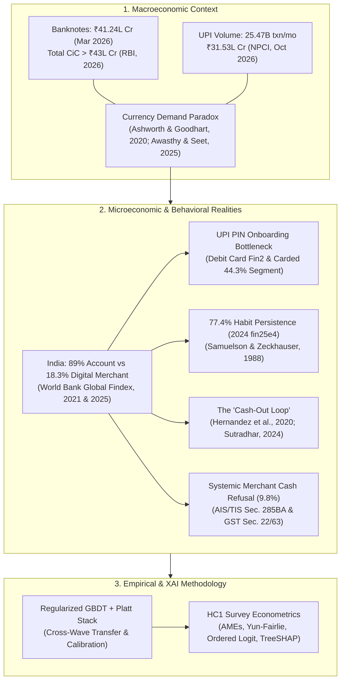
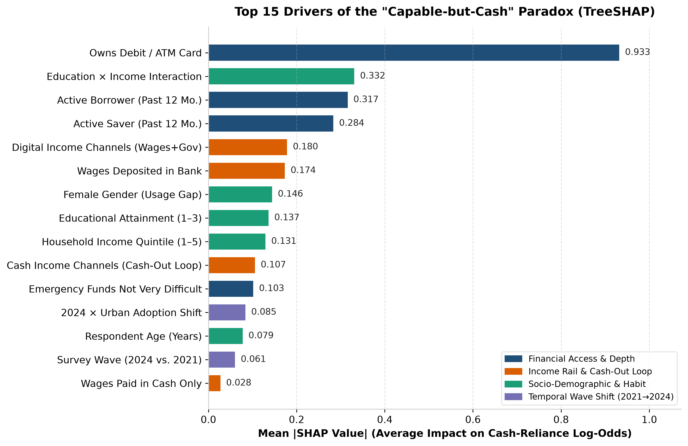
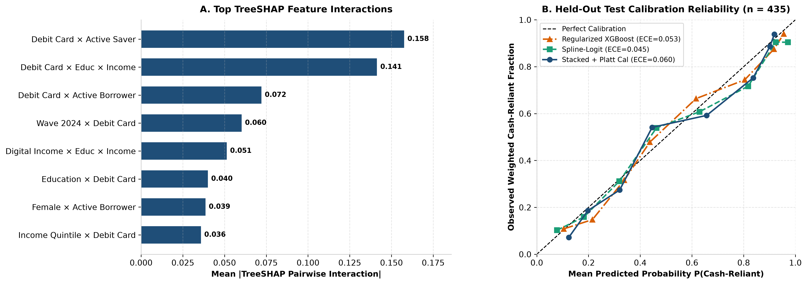
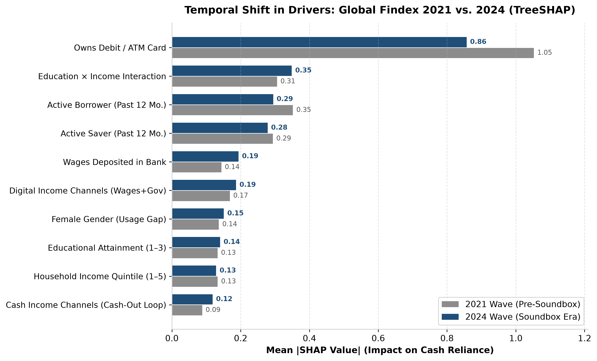
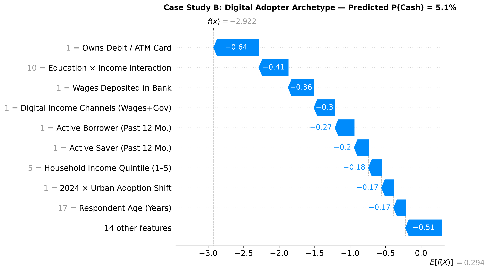
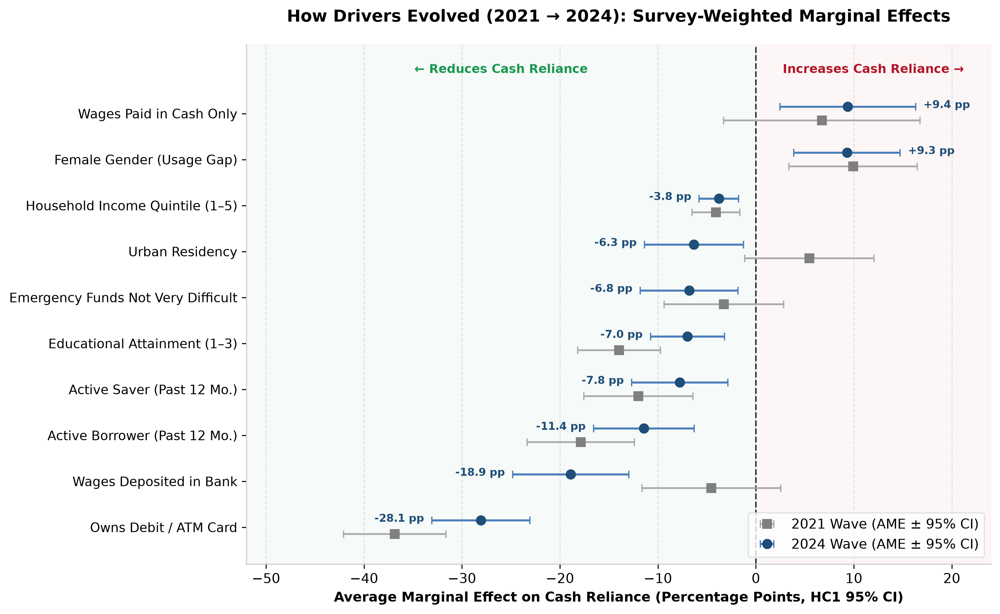
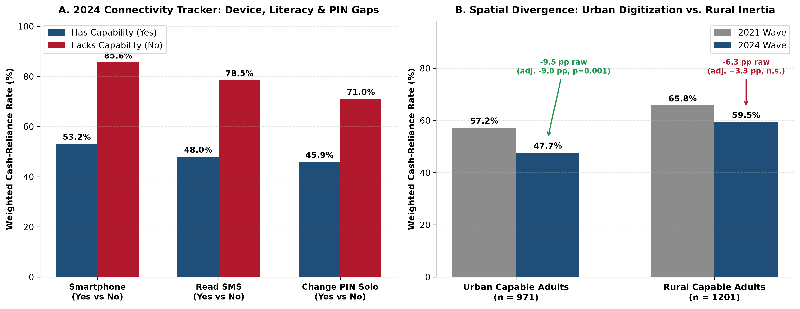

# Analyzing India’s Rising Currency in Circulation: An Explainable Machine Learning and Econometric Audit of the "Capable-but-Cash" Paradox

**Aarush Garg**, **Arya Wadhwa**, and **Dilraj Singh**  
*Department of Information Science and Engineering*  
*RV College of Engineering, Bengaluru, India*

---

## Abstract

Despite the exponential proliferation of India's Unified Payments Interface (UPI)—which grew from 16.58 billion transactions worth ₹23.49 lakh crore in October 2024 to 25.47 billion monthly transactions worth ₹31.53 lakh crore in October 2026 (NPCI, 2026)—India's physical banknotes in circulation expanded by 11.9% in FY 2025–26 to ₹41.24 lakh crore as of March 2026, with total Currency in Circulation (CiC) exceeding ₹43 lakh crore later in 2026 (Reserve Bank of India, 2026). While adult bank account ownership surged to 89.0% in 2024, weighted digital merchant payment adoption in India reached only 18.3%—less than half the 42% low- and middle-income economy (LMIC) average (Klapper et al., 2025). Pooling official World Bank Global Findex India microdata across the 2021 and 2025 (2024 wave) editions ($N = 6,000$), we isolate the **"Capable-but-Cash"** cohort ($N_{\text{cap}} = 2,172$) possessing a bank account, mobile phone, and active internet access, finding that 55.7% unweighted (60.57% in 2021; 54.80% weighted in 2024; 53.16% even among smartphone owners) remain cash-only at point of sale. In the 2024 Findex wave (`fin25e4`), **77.4%** of cash-reliant capable adults cite habit persistence (*"used to paying cash"*), **9.8%** cite merchant cash-only refusal, **6.5%** cite distrust, and only **2.3%** cite higher costs. Combining survey-weighted HC1-robust Spline-Logit, Regularized XGBoost/LightGBM, a Platt-Calibrated 4-Family Stacking Ensemble (5×3 CV ROC-AUC = $0.8483 \pm 0.025$; held-out test AUC = $0.8426$), cross-wave temporal transfer, order-invariant Yun-Fairlie bootstrap decompositions, ordered-logit intensive-margin models, and TreeSHAP interpretability, we show that tree ensembles outperform parametric logits under cross-wave shift (2024$\rightarrow$2021 AUC $0.8622$ vs. $0.8291$), isolate the debit-card UPI onboarding bottleneck alongside the 44.3% carded cash-only behavioral segment, and quantify associational counterfactual cash-reliance reductions of $-8.83$ to $-14.48$ percentage points from Aadhaar-OTP onboarding parity and payroll digitization.

**Keywords:** Financial Inclusion, Digital Payments, Unified Payments Interface (UPI), Currency Demand Paradox, Tax Compliance Friction, AIS/TIS Tracking, Explainable Artificial Intelligence (XAI), TreeSHAP, XGBoost, Econometric Decomposition, Global Findex.

---

## I. Introduction

India's Digital Public Infrastructure (DPI)—anchored by the "India Stack" combining Aadhaar biometric identification, universal bank account access under the Pradhan Mantri Jan Dhan Yojana (PMJDY), and the open, interoperable Unified Payments Interface (UPI) developed by the National Payments Corporation of India (NPCI)—has lowered the marginal technical and fee cost of retail digital payments to near zero (World Bank, 2023; D'Silva et al., 2019; NPCI, 2026). Under orthodox inventory-theoretic money demand models (Baumol, 1952; Tobin, 1956), frictionless electronic rails should steadily contract physical currency demand.

Yet Reserve Bank of India (RBI) and World Bank data expose a two-level paradox:
1. **Macro Digital-Cash Divergence:** Monthly UPI retail volumes scaled from **16.58 billion** (₹23.49 lakh crore) in October 2024 to **25.47 billion** transactions worth **₹31.53 lakh crore** in October 2026, totaling ₹314.23 lakh crore in FY 2025–26 (NPCI, 2026). Concurrently, India's banknotes in circulation grew **11.9%** YoY from ₹36.87 lakh crore (March 2025) to **₹41.24 lakh crore** (March 2026), with total CiC exceeding ₹43 lakh crore later in 2026—overwhelmingly concentrated in ₹500 notes (~85%–86% of note value) (RBI, 2026; Awasthy, Misra, & Dhal, 2022).
2. **Global Account-to-Usage Gap:** While India expanded adult account ownership from 35% in 2011 to **77.5%** in 2021 and **89.0%** in 2024 (Demirgüç-Kunt et al., 2022; Klapper et al., 2025)—matching Kenya ($>89\%$) and exceeding Brazil ($\approx 86\%$)—India's weighted digital merchant payment rate (`merchantpay_dig`) in 2024 is only **18.3%** (up from **11.9%** in 2021), less than half the **42%** LMIC average (61% among account owners), **43%** in Latin America & the Caribbean (anchored by Brazil's Pix; Duarte et al., 2022), and **55.8%** in Kenya (Klapper et al., 2025).

Crucially, macro CiC reflects store-of-value hoarding and informal working capital alongside retail commerce (Ashworth & Goodhart, 2020; Awasthy et al., 2022; Awasthy & Seet, 2025). To avoid ecological fallacy, this paper targets individual **point-of-sale payment choice**, framing the **"Capable-but-Cash" Paradox**:
> *Among Indian adults who already possess a formal bank account, personal mobile phone, and active internet access, which structural, behavioral, and digital-literacy barriers govern continued cash-only merchant behavior, and how did these drivers evolve between 2021 and 2024?*

---

## II. Literature Review & Theoretical Grounding

### A. Currency Demand Paradox & Comparative DPI Benchmarks
Central banking literature across advanced and emerging markets documents the coexistence of electronic payment expansion and rising banknote demand (Ashworth & Goodhart, 2020; Arango, Huynh, & Sabetti, 2015). In India, Awasthy, Misra, & Dhal (2022) and Awasthy & Seet (2025) demonstrate via national and subnational RBI analyses that while UPI substitutes transactional cash in low-ticket payments, precautionary holdings, informal-sector liquidity, income growth, and literacy gaps sustain aggregate currency demand. Globally, Duarte et al. (2022) attribute Brazil's rapid cash displacement under Pix to mandatory participation of major institutions and universal onboarding rails.

### B. UTAUT2, Effort Expectancy, and PIN Onboarding Friction
UTAUT and UTAUT2 (Venkatesh, Morris, Davis, & Davis, 2003; Venkatesh, Thong, & Xu, 2012) establish effort expectancy, facilitating conditions, and perceived risk as core adoption levers (Slade et al., 2015; Oliveira et al., 2016; Migliore et al., 2022). In Indian retail environments, multi-step authentication (SMS OTPs, 4-to-6 digit UPI PINs, Latin-script interfaces) imposes cognitive friction, while transaction failure dread and phishing anxiety erode continuation (Talwar et al., 2020). Institutionally, setting a UPI PIN historically required entering an active debit card's digits and expiry prior to broad Aadhaar-OTP activation, turning missing debit cards into a major structural blocker for banked smartphone owners.

### C. Behavioral Economics: Habit, Mental Accounting & the "Cash-Out Loop"
Behavioral mechanisms explain why zero-fee digital payment fails to trigger instant conversion:
1. **Status-Quo Bias & Habit Persistence:** Decision-makers stick to ingrained motor routines even when switching costs are low (Samuelson & Zeckhauser, 1988).
2. **Mental Accounting & The "Pain of Paying":** Physical currency provides immediate visual and tactile salience of budget depletion (Prelec & Loewenstein, 1998; Thaler, 1999; Soman, 2001).
3. **The "Cash-Out Loop":** When informal workers or benefit recipients receive wages or transfers in cash—or immediately withdraw bank credits at ATMs or cash-in/cash-out (CICO) agents—downstream retail commerce remains locked in cash (Demirgüç-Kunt et al., 2022; Hernandez et al., 2020; Sutradhar, 2024).

### D. Merchant-Side Tax-Compliance Friction: AIS/TIS Scrutiny & GST Cliffs
Under Section 285BA of the Income Tax Act, payment aggregators transmit merchant digital settlement totals to CBDT's **Annual Information Statement (AIS)** and **Taxpayer Information Summary (TIS)**. While Income Tax Section 44AD raises the presumptive taxation ceiling to ₹3 crore (at a 6% vs. 8% rate) when $\ge 95\%$ of receipts are digital, informal retailers remain exposed to far lower **GST registration thresholds** (₹20 lakh services, ₹40 lakh goods under Sections 22 and 63 of the CGST Act). To suppress visible turnover, small vendors frequently conceal QR displays and demand cash, constraining even digitally capable consumers.

### E. Methodological Justification: Why Combine XAI with HC1 Econometrics?
Parametric binary logit models (Mukhopadhyay, 2016; Sutradhar, 2024) require manual interaction specification and can degrade under temporal regime shifts. Regularized gradient boosted trees (Chen & Guestrin, 2016; Maehara, Benites, & Talavera, 2024) paired with TreeSHAP (Lundberg et al., 2020) automatically capture higher-order interactions, while HC1-robust survey-weighted AMEs, Yun-Fairlie decompositions (Yun, 2004; Fairlie, 2005), and Ordered Logit models supply formal statistical inference and confidence intervals.

---

## III. Data Operationalization: World Bank Global Findex (India)

### A. Pooled Two-Wave Survey Architecture
We pool official India microdata from **Global Findex 2021** (`IND_2021_FINDEX_v02_M`, $N = 3,000$, 119 indicators) (Demirgüç-Kunt et al., 2022) and **Global Findex 2025 Edition / 2024 Wave** (`IND_2024_FINDEX_v02_M`, $N = 3,000$, 199 indicators including the Digital Connectivity Tracker) (World Bank, 2025), totaling $N = 6,000$ nationally representative adults aged 15+. Sampling weights (`wgt`) in each wave sum to 3,000. Table I documents verified macro and Findex baseline metrics.

**Table I: Institutional Macro Context and Global Findex India Baselines**
| Empirical Metric | Value | Primary Official Citation |
| :--- | :---: | :--- |
| **India Banknotes in Circulation (Mar 2026)** | **₹41.24 Lakh Crore** | Reserve Bank of India (RBI, 2026) *Annual Report 2025–26* |
| **Banknote Value Growth Rate (FY25–26)** | **11.9%** | Reserve Bank of India (RBI, 2026) *Annual Report 2025–26* |
| **Monthly UPI Volume / Value (Oct 2026)** | **25.47B / ₹31.53L Cr** | NPCI (2026) *UPI Product Statistics* (Oct 2024: 16.58B / ₹23.49L Cr) |
| **Adult Account Ownership (2021 $\rightarrow$ 2024)** | **77.5% $\rightarrow$ 89.0%** | World Bank Global Findex (2021; 2025) |
| **LMIC Digital Merchant Payment Rate (2024)** | **42.0%** *(61% banked)* | World Bank Global Findex 2025 (2021: 35%) |
| **India Digital Merchant Pay Rate (2021 $\rightarrow$ 2024)** | **11.9% $\rightarrow$ 18.3%** | Global Findex India Microdata (Weighted) |
| **Wage Earners Paid Cash-Only (2021 $\rightarrow$ 2024)** | **43.0% $\rightarrow$ 57.4%** | Global Findex India Microdata (`receive_wages == 2` among wage earners) |
| **Stated Barrier (`fin25e4`): Habit / "Used to it"** | **77.4%** *(78.6% all)* | Global Findex 2025 (2024 India Microdata, Capable / All) |
| **Stated Barrier (`fin25e4`): Merchant Accepts Cash Only** | **9.8%** *(9.0% all)* | Global Findex 2025 (2024 India Microdata, Capable / All) |
| **Stated Barrier (`fin25e4`): Distrust in Card/Phone Pay** | **6.5%** *(4.4% all)* | Global Findex 2025 (2024 India Microdata, Capable / All) |
| **Stated Barrier (`fin25e4`): Higher Digital Costs** | **2.3%** *(2.2% all)* | Global Findex 2025 (2024 India Microdata, Capable / All) |

### B. Operational Cohort Definition, Target, and Leak-Free Features
The digitally capable cohort is isolated via:

$$\text{Cohort}_{\text{Capable}} = \left\{ i \;\middle|\; \text{account}_i = 1 \;\land\; \text{mobileowner}_i = 1 \;\land\; \text{internet}_i = 1 \right\}$$

where `mobileowner` maps to `con1` in 2024 and `internet` maps to `internetaccess` (2021) / `internet_use` (2024, past 3 months). The primary target is $Y_i = 1 - \text{merchantpay\_dig}_i$ ($1$ = cash-only at in-store merchants; $0$ = completed a digital merchant payment). Table II summarizes cohort dynamics across waves.

**Table II: Capable Cohort Dynamics across Survey Waves (India)**
| Indicator | Wave 1 (2021) | Wave 2 (2024) | Pooled Two-Wave Sample |
| :--- | :---: | :---: | :---: |
| **Total Surveyed Adults ($N$)** | 3,000 | 3,000 | 6,000 |
| **Formal Bank Account Ownership** | 79.1% (2,372) | 90.3% (2,710) | 84.7% (5,082) |
| **Mobile Phone Ownership** | 69.6% (2,088) | 71.5% (2,145) | 70.6% (4,233) |
| **Active Internet Access** | 31.6% (947) | 51.6% (1,547) | 41.6% (2,494) |
| **Digitally Capable Cohort ($N_{\text{cap}}$)** | **837 (27.9%)** | **1,335 (44.5%)** | **2,172 (36.2%)** |
| **- Digital Adopters ($Y=0$)** | 348 (41.6%) | 614 (46.0%) | 962 (44.3%) |
| **- Cash-Reliant ("Capable-but-Cash", $Y=1$)** | **489 (58.4%)** | **721 (54.0%)** | **1,210 (55.7%)** |
| **Weighted Cash-Reliant Rate** | **60.57%** | **54.80%** | **56.97%** |

To eliminate simultaneous-outcome leakage, all concurrent digital-payment variables (`pay_utilities`, `anydigpayment`, `fin4`, `fin5`, `fin8`, `fin14a`, and digital `remittances`) are excluded. We engineer **23 strictly leak-free features** across four hierarchical blocks:
1. **Socio-Demographics (7):** `age`, `female`, `educ`, `inc_q`, `is_urban`, `emp_in`, `wave_2024`.
2. **Income Rails / Cash-Out Loop (7):** `wage_cash`, `wage_bank`, `gov_cash`, `gov_bank`, `ag_cash`, `cash_inflow_intensity`, `bank_inflow_intensity`.
3. **Financial Depth & Resilience (6):** `has_debit_card` (`fin2`), `saved_formal` (`fin17a`), `saved_any` (`saved`), `borrowed_any` (`borrowed`), corrected `emergency_possible` ($\texttt{fin24} \in [1, 6]$ vs. unable code 7), and `emergency_not_difficult` ($\texttt{fin24a} \in \{2, 3\}$).
4. **Domain & Temporal Interactions (3):** `wave_x_urban`, `wave_x_female`, `educ_x_inc`.

In the 2024 Digital Connectivity Tracker deep-dive ($n = 1,335$), we additionally evaluate smartphone vs. basic phone ownership (`con9`), SMS reading/sending and English-letter comprehension (`con14`, `con16`, `con15`), phone lock and solo PIN-change self-efficacy (`con18`, `con19`), family phone rules (`con20`), scam messages (`con21`), 7-day/daily internet recency (`con24`, `con26`), and mobile data purchases (`con27`).

---

## IV. Empirical Methodology & Hypotheses

### A. Core Empirical Hypotheses
* **Hypothesis 1 ($H_1$ - Habit & Literacy Primacy):** Functional mobile literacy (`con14`, `con16`, `con19`) and educational attainment substantially lower cash reliance beyond basic account and device ownership.
* **Hypothesis 2 ($H_2$ - The Cash-Out Loop):** Physical cash wage and agricultural inflows (`wage_cash`, `ag_cash`) elevate in-store cash reliance, whereas bank-deposited wages (`wage_bank`) sharply curb it.
* **Hypothesis 3 ($H_3$ - Generational Inertia in Older Cohorts):** Rather than a sharp univariate step discontinuity at age 40, adults aged $\ge 40$ exhibit stagnant 2021$\rightarrow$2024 digitization alongside amplified gender and agricultural-cash penalties.
* **Hypothesis 4 ($H_4$ - Onboarding Bottleneck & Residual Behavioral Friction):** Lack of a debit/ATM card (`has_debit_card`) is the primary upstream onboarding barrier, yet a sizable *carded* cash-only sub-cohort remains constrained by habit, trust deficits, and systemic merchant refusal (`fin25e4`).
* **Hypothesis 5 ($H_5$ - The Gender Usage Gap):** Despite formal account parity, female capable adults display persistently higher cash reliance and lower intensive-margin digital payment frequency.

### B. Predictive Architecture, Cross-Wave Transfer & Econometric Inference
1. **Predictive Models & Calibration:** We benchmark survey-weighted **Plain Linear Logit**, **B-Spline + One-Hot Logit**, regularized **XGBoost** (`max_depth=3`, `reg_lambda=2.5`, `reg_alpha=0.5`), regularized **LightGBM**, and a **Platt-Calibrated 4-Family Stack** (Spline-Logit + XGBoost + LightGBM + ExtraTrees) across 5$\times$3 Repeated Stratified K-Fold CV (with out-of-fold threshold tuning), 4-block hierarchical ablation, **cross-wave temporal transfer** (`2021 -> 2024` and `2024 -> 2021`), and held-out test metrics ($n = 435$, including Weighted ECE, paired Wilcoxon tests, DeLong ROC tests, and subgroup fairness parity).
2. **TreeSHAP & Pairwise Interactions:** We extract global importance ($I_j$), directional beeswarms, binned age dependence with 95% CIs, local case-study waterfalls, and exact pairwise TreeSHAP interaction magnitudes via `TreeExplainer.shap_interaction_values`.
3. **HC1 Econometrics, Yun-Fairlie Bootstrap & Intensive Margin:** Survey-weighted Binomial GLMs are fitted with **HC1 Huber-White robust standard errors** (excluding binary indicators with $<10$ minority observations in subgroup/wave splits to prevent quasi-separation). Temporal (2021$\rightarrow$2024) and gender (Female vs. Male) gaps are decomposed using order-invariant **Yun-Fairlie non-linear Blinder-Oaxaca decomposition** (Yun, 2004; Fairlie, 2005) with 300 weighted bootstrap draws for 95% CIs. We further run formal age-nonlinearity checks, endogeneity sensitivity regressions (omitting financial-depth instruments), carded sub-cohort isolation (`has_debit_card == 1`), smartphone-only (`con9 == 1`) robustness, an **Ordered Logit** on 2024 digital payment frequency (`fin25e3`), and associational counterfactual policy simulations.

---

## V. Empirical Results & Discussion

### A. Predictive Benchmarks, Hierarchical Ablation & Cross-Wave Transfer
Table III reports 5$\times$3 CV ablations, hierarchical domain-block progression, out-of-distribution cross-wave generalization, and held-out test evaluation ($n=435$).

**Table III: Leak-Free 5×3 CV, Hierarchical Ablation, Cross-Wave Transfer & Held-Out Metrics**
| Evaluation Regime / Configuration | ROC-AUC | PR-AUC | Brier Score | Weighted ECE | F1-Score |
| :--- | :---: | :---: | :---: | :---: | :---: |
| **5×3 CV: Baseline XGBoost (9 Core Vars)** | $0.7367 \pm 0.028$ | 0.7869 | 0.2049 | 0.0574 | 0.7259 |
| **5×3 CV: Block 1 Demographics (XGBoost, 7 Vars)** | $0.7205 \pm 0.028$ | 0.7717 | 0.2103 | — | — |
| **5×3 CV: Block 2 + Income Rails (XGBoost, 14 Vars)** | $0.7636 \pm 0.026$ | 0.8054 | 0.1939 | — | — |
| **5×3 CV: Block 3 + Depth & Resilience, No Card (19 Vars)** | $0.7935 \pm 0.028$ | 0.8353 | 0.1823 | — | — |
| **5×3 CV: Ablation XGBoost (No Debit Card, 22 Vars)** | $0.7924 \pm 0.028$ | 0.8319 | 0.1828 | 0.0605 | 0.7598 |
| **5×3 CV: Plain Linear Logit (23 Vars)** | $0.8481 \pm 0.024$ | 0.8810 | **0.1570** | 0.0617 | 0.7933 |
| **5×3 CV: Spline + OneHot Logit (23 Vars)** | $0.8477 \pm 0.025$ | 0.8803 | **0.1570** | 0.0544 | **0.7946** |
| **5×3 CV: Regularized XGBoost (23 Vars)** | **$0.8483 \pm 0.025$** | **0.8825** | **0.1570** | 0.0558 | 0.7943 |
| **5×3 CV: Regularized LightGBM (23 Vars)** | $0.8466 \pm 0.025$ | 0.8779 | 0.1580 | **0.0508** | 0.7909 |
| **5×3 CV: Stacked Ensemble + Platt Cal** | $0.8476 \pm \mathbf{0.023}$ | 0.8817 | 0.1594 | 0.0634 | 0.7788 |
| **Cross-Wave (`2024 -> 2021`): Spline-Logit** | 0.8291 | 0.8612 | 0.1652 | 0.0664 | — |
| **Cross-Wave (`2024 -> 2021`): Regularized XGBoost** | **0.8622** | **0.9062** | **0.1491** | 0.0555 | — |
| **Cross-Wave (`2024 -> 2021`): Regularized LightGBM** | 0.8543 | 0.8897 | 0.1525 | **0.0446** | — |
| **Cross-Wave (`2021 -> 2024`): Spline-Logit** | 0.8085 | **0.8412** | 0.1845 | 0.0856 | — |
| **Cross-Wave (`2021 -> 2024`): Regularized XGBoost** | **0.8122** | 0.8397 | 0.1790 | 0.0596 | — |
| **Cross-Wave (`2021 -> 2024`): Regularized LightGBM** | 0.8111 | 0.8342 | **0.1783** | **0.0572** | — |
| **Held-Out Test ($n=435$): Spline-Logit** | 0.8362 | 0.8587 | 0.1641 | **0.0452** | **0.8045** |
| **Held-Out Test ($n=435$): Regularized XGBoost** | 0.8409 | **0.8622** | 0.1610 | 0.0532 | 0.8000 |
| **Held-Out Test ($n=435$): Stacked + Platt Cal** | **0.8426** | 0.8594 | **0.1605** | 0.0599 | 0.7770 |

Paired Wilcoxon tests confirm highly significant gains over the 9-variable baseline ($+0.1116$ AUC, $p = 6.1 \times 10^{-5}$) and no-debit-card ablation ($+0.0559$ AUC, $p = 6.1 \times 10^{-5}$). While in-distribution CV discrimination ties between Spline-Logit and XGBoost (Wilcoxon $p = 0.639$; held-out DeLong $p = 0.364$, Stack vs. Spline-Logit DeLong $p = 0.092$), tree ensembles demonstrate **superior out-of-distribution temporal generalization**—improving `2024 -> 2021` AUC by **+3.31 points** ($0.8622$ vs. $0.8291$) with sharply lower calibration error (LightGBM ECE $0.0446$ vs. $0.0664$, and $0.0572$ vs. $0.0856$ on `2021 -> 2024`). Held-out fairness checks on the calibrated stack yield AUC $0.8747$ (female) vs. $0.8257$ (male) and $0.8502$ (rural) vs. $0.8304$ (urban), with lower accuracy in the small $\ge 40$ subgroup ($0.7606$, $n=100$).

### B. TreeSHAP Attributions, Pairwise Interactions & Calibration
Table IV compares TreeSHAP importance rankings (**Figure 1**) against HC1-robust GLM Odds Ratios. Upstream debit card possession (`has_debit_card`) leads ($I_j = 0.9330$, $\text{OR} = 0.12$), followed by `educ_x_inc` ($0.3320$), `borrowed_any` ($0.3169$), `saved_any` ($0.2843$), `bank_inflow_intensity` ($0.1796$), `wage_bank` ($0.1745$), and `female` ($0.1455$, $\text{OR} = 1.95$). The directional beeswarm (**Figure 2**) visualizes positive vs. negative feature risk directions, while pairwise TreeSHAP interactions (**Figure 3A**) identify `has_debit_card × saved_any` ($0.158$), `has_debit_card × educ_x_inc` ($0.141$), and `has_debit_card × borrowed_any` ($0.072$) as top non-linear synergies, alongside tight probability calibration across quantile reliability bins (**Figure 3B**). Supplementary diagnostic visualizations plot the binned age-dependence curve with 95% confidence bands (**Figure 4**), the 2021-vs-2024 temporal shift in SHAP importances (**Figure 5**), and local waterfall decompositions contrasting the highest-risk cash-reliant archetype (**Figure 6**) against the lowest-risk digital-adopter archetype (**Figure 7**).

*Figure 1: Top 15 leak-free predictors of cash reliance ranked by Mean $|SHAP|$ across the pooled capable cohort ($N_{\text{cap}} = 2,172$).*

*Figure 2: Directional TreeSHAP beeswarm illustrating how feature values shift log-odds toward cash reliance or digital merchant payments.*

*Figure 3: (A) Top pairwise TreeSHAP interaction magnitudes explaining cross-wave GBDT transfer gains; (B) Held-out test weighted reliability curves across quantile bins ($n=435$).*

*Figure 4: Age-gradient TreeSHAP dependence trajectory with binned means and 95% confidence intervals.*

*Figure 5: Temporal comparison of wave-specific TreeSHAP feature importances between 2021 and 2024.*

*Figure 6: Local TreeSHAP waterfall Case Study A decomposing the highest-risk cash-reliant held-out individual.*

*Figure 7: Local TreeSHAP waterfall Case Study B decomposing the lowest-risk digital-adopter held-out individual.*

**Table IV: Top Leak-Free Predictors (TreeSHAP Importance & HC1 GLM Odds Ratios)**
| Rank | Feature Code | Description | Mean $|SHAP|$ ($I_j$) | HC1 GLM Odds Ratio ($p$-value) |
| :---: | :--- | :--- | :---: | :---: |
| **1** | `has_debit_card` | Possesses an ATM/debit card (`fin2`) | **0.9330** | **0.12 ($p < 10^{-34}$)** |
| **2** | `educ_x_inc` | Education $\times$ Income interaction | **0.3320** | — |
| **3** | `borrowed_any` | Active borrowing behavior (`borrowed`) | **0.3169** | 0.39 ($p < 10^{-9}$) |
| **4** | `saved_any` | Active saving behavior (`saved`) | **0.2843** | 0.42 ($p < 10^{-5}$) |
| **5** | `bank_inflow_intensity` | Count of formal digital income channels | **0.1796** | — |
| **6** | `wage_bank` | Wages deposited into bank account | **0.1745** | 0.42 ($p < 10^{-6}$) |
| **7** | `female` | Female gender indicator (Gender Gap) | **0.1455** | **1.95 ($p = 0.004$)** |
| **8** | `educ` | Educational attainment level | **0.1375** | 0.50 ($p < 10^{-9}$) |
| **9** | `inc_q` | Household income quintile | **0.1305** | 0.75 ($p < 10^{-5}$) |
| **10** | `cash_inflow_intensity` | Cash income channels (`wage+gov+ag`) | **0.1067** | `wage_cash`: **2.22 ($p < 10^{-3}$)** |
| **11** | `emergency_not_difficult` | Emergency funds somewhat/not difficult (`fin24a`) | **0.1028** | **0.67 ($p = 0.006$)** |
| **12** | `wave_x_urban` | 2024 $\times$ Urban shift interaction | **0.0852** | **0.42 ($p = 0.002$)** |

### C. Econometric Extensions, Yun-Fairlie Decomposition & Robustness
Table V consolidates the wave-separated HC1 AMEs, Yun-Fairlie decompositions with 300-draw bootstrap CIs, carded isolation, endogeneity sensitivity, and 2024 Tracker audits.

**Table V: Econometric Audit Summary (HC1 AMEs, Yun-Fairlie Bootstrap CIs & Robustness)**
| Analytical Module / Comparison | Primary Finding / Metric | Estimate / 95% CI | $p$-value |
| :--- | :--- | :---: | :---: |
| **Wave AME (`wage_bank`)** | 2021 $\rightarrow$ 2024 Marginal Effect | $-4.5$ pp $\rightarrow$ **$-18.9$ pp** | $0.211 \rightarrow <10^{-9}$ |
| **Wave AME (`wage_cash`)** | 2024 Overall / Urban Subgroup | **$+9.4$ pp** / **$+16.7$ pp** | $0.008$ / $<0.001$ |
| **Wave AME (`is_urban`)** | 2021 $\rightarrow$ 2024 Marginal Effect | $+5.5$ pp $\rightarrow$ **$-6.3$ pp** | $0.105 \rightarrow 0.014$ |
| **Subgroup (`wave_2024`)** | Urban ($n=971$) vs. Rural ($n=1,201$) | **$-9.2$ pp** vs. $+3.7$ pp | $0.002$ vs. $0.203$ |
| **Age Nonlinearity Test ($H_3$)** | Hinge `max(0, age - 40)` / `age^2` | $-0.0087$ / $-0.0004$ | $0.695$ / $0.385$ |
| **Subgroup Age $\ge 40$ ($n=540$)** | `female` AME / `wave_2024` AME | **$+14.7$ pp** / $+5.8$ pp | $0.003$ / $0.195$ |
| **No-Depth Sensitivity** | `wage_bank` / `wage_cash` / `female` | $-23.8$ / $+11.8$ / $+10.7$ pp | all $<0.001$ |
| **Carded Sub-Cohort ($N=1,435$)** | `female` / `wage_bank` / `ag_cash` AMEs | $+9.4$ / $-17.3$ / $+16.0$ pp | $\le 0.009$ |
| **Yun-Fairlie: 2021 $\rightarrow$ 2024** | $-5.76$ pp drop (60.57% $\rightarrow$ 54.80%) | **50.6%** Endow. / **49.4%** Behav. | $[-0.4, +7.3]$ pp CI |
| **Yun-Fairlie: Gender Gap** | $+14.87$ pp gap (66.92% F vs. 52.05% M) | **52.1%** [35.5–71.5%] Endow. | $<0.001$ |
| **2024 Tracker (`con16`, `con19`)** | `can_send_sms` / `can_change_pin_solo` | **$-18.3$ pp** / **$-7.5$ pp** | $<10^{-4}$ / $0.024$ |
| **2024 Smartphone Only (`con9=1`)** | Cash-Reliant Rate ($n=1,276$) | **53.16%** (`wage_bank` $-19.3$ pp) | $<10^{-9}$ |
| **Intensive Margin (`fin25e3`)** | Ordered Logit OR: `female` / `can_read_sms` | **0.69** / **2.15** | $0.036$ / $0.013$ |

*Figure 8: Wave-separated survey-weighted Average Marginal Effects (percentage points with HC1 95% CIs) in 2021 vs. 2024.*

*Figure 9: (A) Order-invariant Yun-Fairlie gap decomposition; (B) Self-reported cash-only barriers in 2024 (`fin25e4`, $n=711$).*

*Figure 10: (A) 2024 device, SMS literacy, and solo PIN self-efficacy gaps; (B) Urban digitization ($-9.2$ pp adj.) vs. rural stagnation ($+3.7$ pp adj., n.s.).*

Key takeaways from the econometric suite:
1. **Formal Rejection of Univariate Age-40 Step vs. Confirmation of Older-Cohort Inertia ($H_3$):** Formal hinge ($p = 0.695$) and quadratic ($p = 0.385$) tests refute a discontinuous slope break at age 40; instead, `Age >= 40` adults saw zero 2021$\rightarrow$2024 digitization progress ($+5.8$ pp, $p = 0.195$ vs. $-7.1$ pp, $p = 0.003$ under 40) and a doubled $+14.7$ pp female penalty ($p = 0.003$).
2. **Carded Behavioral Segment ($H_4$):** Among the 1,210 cash-reliant capable adults, **55.7%** lack a debit card while **44.3%** ($n=549$) *already own a debit card*. Within all 1,435 carded capable adults (39.4% cash-reliant), `female` ($+9.4$ pp), `wage_bank` ($-17.3$ pp), and `ag_cash` ($+16.0$ pp) remain powerful drivers.
3. **2024 Connectivity Tracker & Intensive Margin:** Incorporating 2024 Connectivity Tracker features yields 5$\times$3 CV XGBoost ROC-AUC $= 0.8410 \pm 0.020$ (PR-AUC $= 0.8676$). Even restricting strictly to smartphone owners (`con9 == 1`, $n=1,276$), 53.2% remain cash-only (vs. 85.6% on feature phones). Active texting (`can_send_sms`, $-18.3$ pp, SHAP $= 0.3372$) and solo PIN self-efficacy (`can_change_pin_solo`, $-7.5$ pp, SHAP $= 0.1160$) sharply cut cash reliance, while Ordered Logit on digital frequency (`fin25e3`, $n=562$) proves women pay digitally less frequently ($\text{OR} = 0.69, p = 0.036$) and SMS-literate adults transact over twice as often ($\text{OR} = 2.15, p = 0.013$). Meanwhile, stated merchant cash-only refusal (`fin25e4 == 1`, $n=711$) has no significant relationship with gender, education, income, urbanicity, wage cash, or debit cards ($p \ge 0.07$; age $p = 0.050$), confirming systemic market-wide refusal.

---

## VI. Policy Counterfactuals & Behavioral Architecture

Using the calibrated 4-family ensemble on the 2024 capable cohort ($n=1,335$, baseline predicted cash reliance $55.39\%$, observed $54.80\%$), Table VI summarizes model-implied associational policy counterfactuals:

**Table VI: Associational Policy Counterfactual Simulations (2024 Capable Cohort)**
| Policy Scenario | Predicted Cash Reliance | Shift vs. Baseline (pp) |
| :--- | :---: | :---: |
| **Observed 2024 Weighted Rate** | 54.80% | — |
| **Baseline Calibrated Model (2024)** | 55.39% | — |
| **Scenario 1: Aadhaar-OTP Onboarding Parity (`has_debit_card = 1`)** | **46.56%** | **$-8.83$ pp** |
| **Scenario 2: Payroll Digitization (`wage_cash -> wage_bank`)** | **51.44%** | **$-3.95$ pp** |
| **Scenario 3: Combined Onboarding + Payroll Digitization** | **40.91%** | **$-14.48$ pp** |

1. **Universal Cardless Onboarding (Aadhaar-OTP / Biometric UPI):** Eliminating debit-card PIN setup friction targets the 55.7% cardless segment, associated with an **$-8.83$ pp** reduction in cash reliance.
2. **Intercepting the Cash-Out Loop:** MSME payroll digitization via UPI AutoPay and targeted DBT retail cashback pair with universal onboarding for a combined **$-14.48$ pp** shift.
3. **Harmonizing GST Cliffs with Section 44AD Safe-Harbors:** Aligning a digital-only GST composition safe-harbor with Income Tax Section 44AD's ₹3 crore digital threshold neutralizes vendor anxiety over Section 63 GST/AIS triggers.
4. **Default PIN-Light & Vernacular Architecture:** Defaulting sub-₹500 retail payments to zero-PIN on-device wallets (UPI Lite), mandating 60-second failure reversals, and deploying Bhashini voice interfaces directly address the 44.3% carded behavioral segment, low PIN self-efficacy (`con19`), and older/female usage gaps.

---

## VII. Limitations & Threats to Validity

1. **Cross-Sectional Observational Design:** Global Findex waves are repeated cross-sections rather than longitudinal panels; TreeSHAP values, AMEs, and counterfactual simulations represent predictive associations rather than causal estimates.
2. **Supply-Side Tax Link:** Findex surveys consumers (`fin25e4`) rather than merchant tax filings; the AIS/GST compliance channel is therefore a theoretically grounded institutional explanation consistent with uniform consumer refusal reports rather than directly observed vendor turnover.
3. **Proxy Granularity:** Constructs such as habit persistence and PIN anxiety are measured using discrete survey items rather than multi-item psychometric instruments.

---

## VIII. Conclusion

Combining pooled Global Findex India waves ($N=6,000$; $N_{\text{cap}}=2,172$), regularized GBDTs, Platt calibration, TreeSHAP interactions, HC1-robust econometrics, and Yun-Fairlie bootstrap decompositions, this study resolves why 54.8% of technologically equipped Indian adults remain cash-only at retail storefronts. Bridging India's world-leading account penetration (89.0%) and lagging merchant usage (18.3%) requires removing debit-card UPI onboarding hurdles, intercepting cash payrolls, harmonizing micro-merchant GST/AIS safe-harbors, and deploying PIN-light vernacular payment UX.

---

## References

1. Arango, C., Huynh, K. P., & Sabetti, L. (2015). Consumer payment choice: Merchant card acceptance versus pricing incentives. *Journal of Banking & Finance*, 55, 130–141.
2. Ashworth, J., & Goodhart, C. A. E. (2020). Coronavirus panic fuels a surge in cash demand. *CEPR Discussion Paper*, DP14910.
3. Awasthy, S., Misra, R., & Dhal, S. (2022). Cash versus Digital Payment Transactions in India: Decoding the Currency Demand Paradox. *Reserve Bank of India Occasional Papers*, 43(2), 1–45.
4. Awasthy, S., & Seet, S. K. (2025). Impact of UPI on Cash Demand – Evidence from National and Subnational Levels. *Reserve Bank of India (RBI) Bulletin*, Sep. 2025, 79 ff.
5. Baumol, W. J. (1952). The Transactions Demand for Cash: An Inventory Theoretic Approach. *The Quarterly Journal of Economics*, 66(4), 545–556.
6. Chen, T., & Guestrin, C. (2016). XGBoost: A Scalable Tree Boosting System. *Proc. ACM SIGKDD*, 785–794.
7. DeLong, E. R., DeLong, D. M., & Clarke-Pearson, D. L. (1988). Comparing the areas under two or more correlated receiver operating characteristic curves: A nonparametric approach. *Biometrics*, 44(3), 837–845.
8. Demirgüç-Kunt, A., Klapper, L., Singer, D., & Ansar, S. (2022). *The Global Findex Database 2021: Financial Inclusion, Digital Payments, and Resilience in the Age of COVID-19*. World Bank.
9. D'Silva, D., Filková, Z., Packer, F., & Tiwari, S. (2019). The design of digital financial infrastructure: lessons from India. *BIS Papers*, No. 106.
10. Duarte, A., Frost, J., Gambacorta, L., Koo Wilkens, P., & Shin, H. S. (2022). Central banks, the monetary system and public payment infrastructures: lessons from Brazil's Pix. *BIS Bulletin*, No. 52.
11. Fairlie, R. W. (2005). An extension of the Blinder-Oaxaca decomposition technique to logit and probit models. *Journal of Economic and Social Measurement*, 30(4), 305–316.
12. Hernandez, E., Blackburn, C., Raman, A., & Reynolds, P. (2020). *Agent Network Journeys Toward the Last Mile: A Cross-Country Perspective*. CGAP / World Bank Group.
13. Klapper, L., Singer, D., Starita, L., & Norris, A. (2025). *The Global Findex Database 2025: Connectivity and Financial Inclusion in the Digital Economy*. World Bank Publications.
14. Lundberg, S. M., et al. (2020). From local explanations to global understanding with explainable AI for trees. *Nature Machine Intelligence*, 2(1), 56–67.
15. Maehara, R., Benites, L., Talavera, A., Aybar-Flores, A., & Muñoz, M. (2024). Predicting Financial Inclusion in Peru: Application of Machine Learning Algorithms. *Journal of Risk and Financial Management*, 17(1), 34.
16. Migliore, G., Wagner, R., Cechella, F. S., & Liébana-Cabanillas, F. (2022). Antecedents to the Adoption of Mobile Payment in China and Italy: an Integration of UTAUT2 and Innovation Resistance Theory. *Information Systems Frontiers*, 24(6), 2099–2122.
17. Mukhopadhyay, B. (2016). Understanding cashless payments in India. *Financial Innovation*, 2(1), 27.
18. NPCI. (2026). *UPI Product Statistics*. National Payments Corporation of India.
19. Oliveira, T., Thomas, M., Baptista, G., & Campos, F. (2016). Mobile payment: Understanding the determinants of customer adoption and intention to recommend the technology. *Computers in Human Behavior*, 61, 404–414.
20. Prelec, D., & Loewenstein, G. (1998). The Red and the Black: Mental Accounting of Savings and Debt. *Marketing Science*, 17(1), 4–28.
21. Reserve Bank of India. (2026). *Annual Report 2025–26*. Reserve Bank of India Publications.
22. Samuelson, W., & Zeckhauser, R. (1988). Status quo bias in decision making. *Journal of Risk and Uncertainty*, 1(1), 7–59.
23. Slade, E. L., Dwivedi, Y. K., Piercy, N. C., & Williams, M. D. (2015). Modeling consumers’ adoption intentions of remote mobile payments in the United Kingdom: Extending UTAUT with innovativeness, risk, and trust. *Psychology & Marketing*, 32(8), 860–873.
24. Soman, D. (2001). Effects of payment mechanism on spending behavior: The role of rehearsal and immediacy of payments. *Journal of Consumer Research*, 27(4), 460–474.
25. Sutradhar, T. K. (2024). Status and Determinants of Digital Transactions in India: Findings from the New Global Findex Database. *Vidyasagar University Journal of Economics*.
26. Talwar, S., Dhir, A., Khalil, A., Mohan, G., & Najmul Islam, A. K. M. (2020). Point of adoption and beyond. Initial trust and mobile-payment continuation intention. *Journal of Retailing and Consumer Services*, 55, 102086.
27. Thaler, R. H. (1999). Mental accounting matters. *Journal of Behavioral Decision Making*, 12(3), 183–206.
28. Tobin, J. (1956). The Interest-Elasticity of Transactions Demand For Cash. *The Review of Economics and Statistics*, 38(3), 241–247.
29. Venkatesh, V., Morris, M. G., Davis, G. B., & Davis, F. D. (2003). User acceptance of information technology: Toward a unified view. *MIS Quarterly*, 27(3), 425–478.
30. Venkatesh, V., Thong, J. Y., & Xu, X. (2012). Consumer acceptance and use of information technology: Extending the unified theory of acceptance and use of technology. *MIS Quarterly*, 36(1), 157–178.
31. World Bank. (2023). *G20 Policy Recommendations for Advancing Financial Inclusion and Productivity Gains through Digital Public Infrastructure*. World Bank Group.
32. Yun, M.-S. (2004). Decomposing differences in the first moment. *Economics Letters*, 82(2), 275–280.
